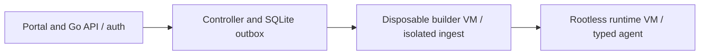

# PH1 - Secure core

An administrator submits an approved repository, follows an isolated build, and opens a healthy application through authenticated private ingress.

These documents explain planned design and acceptance. Current implementation and test results remain in the [project status](../../PROJECT-STATUS.md) and linked milestone evidence.

The drawing is a responsibility overview, not a network connectivity or deployment topology.

## Minimal track

Source: [minimal plan](../../docs/plans/PH1/minimal.md). Recommended adds to minimal; hardened adds to both. Follow explicit cross-track dependencies.

| Milestone | Feature |
|---|---|
| [P1-M01](p1-m01.md) | Scaffold domain/protocol contracts and fixture inventory; document capability checklist |
| [P1-M02](p1-m02.md) | Initial SQLite migrations, version lock and state/outbox transaction adapter |
| [P1-M03](p1-m03.md) | Bootstrap admin, Argon2id, sessions, CSRF and role middleware |
| [P1-M04](p1-m04.md) | Fixed VM template/provisioner contract and hard-expiry lifecycle |
| [P1-M05](p1-m05.md) | External build egress broker and firewall template |
| [P1-M06](p1-m06.md) | Clone runner with HTTPS/ref/context limits and malicious Git fixtures |
| [P1-M07](p1-m07.md) | Rootless BuildKit export and isolated ingest/scanner adapter |
| [P1-M08](p1-m08.md) | Strict Compose/Dockerfile normalization and agent policy contract |
| [P1-M09](p1-m09.md) | Runtime capability probe and typed agent create/inspect/stop |
| [P1-M10](p1-m10.md) | Managed volume ownership/quota and secret-reference adapter |
| [P1-M11](p1-m11.md) | HTTP auth gateway, private relay path and atomic exact-host route activation |
| [P1-M12](p1-m12.md) | Job controller main state machine, cancellation and orphan reconciliation |
| [P1-M13](p1-m13.md) | Login/sidebar/admin deploy wizard, timeline and text-only bounded logs |
| [P1-M14](p1-m14.md) | Secure-core acceptance harness and operator setup/backup smoke runbook |

## Recommended track

Source: [recommended plan](../../docs/plans/PH1/recommended.md). Recommended adds to minimal; hardened adds to both. Follow explicit cross-track dependencies.

| Milestone | Feature |
|---|---|
| [P1-R01](p1-r01.md) | Versioned encrypted credential references and scoped broker API |
| [P1-R02](p1-r02.md) | HTTPS Git broker with exact-origin credential injection |
| [P1-R03](p1-r03.md) | Worker enrollment, short-lived certificates and rotation/revocation |
| [P1-R04](p1-r04.md) | Artifact retention and digest/provenance inventory |
| [P1-R05](p1-r05.md) | SQLite online backup, key export procedure and isolated restore drill |
| [P1-R06](p1-r06.md) | Controller crash matrix, cleanup incident dashboard and queue backpressure |

## Hardened track

Source: [hardened plan](../../docs/plans/PH1/hardened.md). Recommended adds to minimal; hardened adds to both. Follow explicit cross-track dependencies.

| Milestone | Feature |
|---|---|
| [P1-H01](p1-h01.md) | Reproducible signed VM template manifest and verification path |
| [P1-H02](p1-h02.md) | Dedicated builder-host provisioning with isolated host-control network |
| [P1-H03](p1-h03.md) | Syscall/MAC profile regression harness and host reserve stress test |
| [P1-H04](p1-h04.md) | Append-only external audit export with durable outbox retry |
| [P1-H05](p1-h05.md) | Independent adversarial review of provisioner/ingest/agent boundary |
