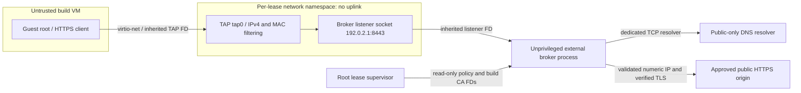

# P1-M05 — External build egress broker and firewall template

Status: **Implemented/tested; isolated-KVM acceptance PASS**.
The implementation includes the external inspecting broker, Linux namespace/TAP
integration, QEMU descriptor inheritance, durable ownership, cancellation,
independent expiry and crash reconciliation. Real KVM smoke/fault results and
remaining acceptance evidence are recorded in the [evidence report](../../docs/project/PH1/P1M05/implementation-evidence.md).

[Phase index](README.md) | [Milestone contract](../../docs/project/PH1/P1M05/README.md) | [Operator runbook](../../infra/egress/README.md)

## Purpose and boundaries

Build guests may fetch approved public HTTPS dependencies through an external
TLS-inspecting broker. Guest root cannot select a different lease or use a
routed internet/management path. M04 execution remains disabled unless the
operator configures the real backend; its empty/`none` network mode stays
no-NIC. `broker-v1` is explicit host-local opt-in. Provisioner RPC shapes,
build-small-v1 budgets and guest trust assumptions are unchanged. Repository
cloning, credentials, BuildKit and artifact ingest remain later milestones.

## Concrete topology and design decision



The namespace contains only the TAP, its fixed connected subnet and the broker
listener. It has no veth, bridge, NAT, uplink, host service or default route.
The broker supervisor opens the listening socket in that namespace and then
restores its original host network namespace **before** launching the
unprivileged broker. Accepted sockets retain the listener's namespace; newly
created upstream sockets use the host namespace. This replaces the planned
routed namespace with a smaller connectivity surface and needs no host firewall
changes or host forwarding. The broker remains outside the VM trust boundary.

The guest has MAC `02:00:00:00:00:02`, IPv4 `192.0.2.2/30` and proxy
`http://192.0.2.1:8443`. Address reuse across jobs is safe because each listener
and TAP live in a separate namespace. No guest headers carry identity. A
host-assigned listener and its peer IPv4 bind each process to one lease.

## Components and interfaces

| Component | Responsibility |
|---|---|
| `internal/egress/policy.go` | Strict versioned policy, exact authority, address classification, hash |
| `internal/egress/broker.go` | CONNECT/TLS/HTTP inspection, pinned DNS dialing, upstream verification, lease cancellation, sanitized decisions |
| `internal/egress/limits.go` | Pre-CONNECT socket cap, per-direction pacing and cancellation |
| `cmd/egress-broker` | Isolated child process, explicit configuration, inherited input capabilities, absolute deadline and read-only hash inspection |
| `internal/provisioner/linux_network_linux.go` | Namespace/TAP ownership and filtering, broker systemd unit, descriptor acquisition, lifecycle/recovery |
| `internal/provisioner/linux_backend_linux.go` | Existing lease fence, independent timer, QEMU quotas and cleanup integrated with network state |
| `infra/egress` | Policy/firewall examples, operator instructions, guest probe and opt-in lab harness |

`LinuxConfig` adds network_mode, policy path/hash, build CA certificate/key
paths, CA DER hash, dedicated resolver IP:53, broker executable and dedicated
UID/GID. Every field is operator-owned, never accepted from deployment RPC.
Unknown modes, incomplete pins, unsafe paths, conflicting users, unknown
policy versions and unsupported host dependencies fail closed before creation.
The dedicated account must be named `orchestrator-egress`, distinct from
`orchestrator-qemu`. All configuration/key paths have trusted root-owned
ancestors. Network configuration must be absent in no-NIC mode.

## Policy, DNS and inspected HTTP

Policy version 1 contains exact lowercase ASCII DNS names, explicit
infrastructure deny CIDRs, max_connections, max_bytes, duration_seconds and
optional bytes_per_second (default 1 MiB/s per direction, at most 64 MiB/s).
An empty host allowlist is valid and denies every origin. JSON parsing rejects
unknown/duplicate keys, trailing JSON, malformed UTF-8 and inputs over 64 KiB.
SHA-256 of the typed serialization binds the policy to the durable lease;
construction copies policy slices without changing its identity.

Authorities require hostname:443. IP literals, userinfo, escapes, uppercase,
trailing dots, wildcards and alternate ports are rejected. The dedicated
resolver has no internal zones and is contacted over TCP. Every A/AAAA answer
must pass classification before selecting an address; mixed public/private
answers, empty results, resolver errors and more than 64 answers fail closed.
The dial target is numeric, preventing a second resolution. Each request has
its own upstream transport, without connection reuse or redirect following.
Upstream TLS uses the original DNS hostname and system trust roots.

IPv4 denies unspecified/private/shared/loopback/link-local/metadata,
documentation, benchmarking, multicast and reserved space. IPv6 permits only
2000::/3 global unicast with protocol assignment, documentation and transition
space excluded. Mapped IPv6 and zones are denied. Operator CIDRs also deny
infrastructure with otherwise public addresses. Update the conservative
classification registry when address allocations change.

```mermaid
sequenceDiagram
 participant G as Guest
 participant B as External broker
 participant R as Dedicated resolver
 participant U as Approved origin
 G->>B: CONNECT approved-host:443
 B->>B: Peer identity, policy hash, lease and concurrency
 B-->>G: 200, then build-CA TLS certificate
 G->>B: TLS SNI = approved-host
 G->>B: One HTTP/1.1 request with matching authority
 B->>B: Reject tunnels/upgrades/ambiguous authority
 B->>R: Resolve A/AAAA
 R-->>B: Answers
 B->>B: Validate every answer
 B->>U: Dial pinned IP; verify upstream TLS hostname
 U-->>B: Response
 B->>B: Reject redirects/upgrades; bound output
 B-->>G: Inspected response, then close
```

Each leaf uses a fresh P-256 key, with its expiry capped by the CA and lease.
The CA signing key stays outside the guest. The public CA must be installed in
the pinned credential-free template. CONNECT authority, SNI and HTTP authority
must agree; omitted HTTP port means 443. The broker rejects nested CONNECT,
absolute-form targets, upgrades and Connection headers, and strips proxy
credentials. It closes after one request, including failures. Redirects and
switching protocols produce no upstream response disclosure to the client.

## Resource and diagnostic bounds

A listener semaphore bounds raw sockets, including slow pre-CONNECT clients;
a second semaphore bounds active inspected requests. The server has header,
read, idle and write timeouts, and inspected HTTP has a 32 KiB header bound.
Total input and serialized output have byte budgets. Transfers are paced per
direction with at most a 16 KiB burst. Remaining lease time and maximum session
duration bound TLS, resolution, dialing and streaming. Cancellation closes
hijacked sockets and propagates into upstream transport and pacing.

The broker emits only a fixed reason code and policy hash: admission_denied,
client_denied, upstream_denied, response_denied, transfer_denied or allowed.
It does not log hosts, headers, query URLs, bodies, credentials or resolver/TLS
error text. Transient service journal rate is bounded. Startup failures are
generic. Read-only `-inspect` prints canonical policy and public CA hashes
without loading a signing key or starting networking.

## Ownership journal and compatibility

Legacy no-NIC host journals have Version=0 and no Network record. Networked
journals have Version=1 and a nested Version=1 hostNetwork containing:

| Field | Meaning |
|---|---|
| Namespace | Deterministic opaque name from job ID and ownership proof |
| Dev, Ino | Observed namespace filesystem device/inode identity |
| PolicyHash | Pinned operator policy identity |
| Enforced | Namespace filtering installed before device activation |
| Removed | Removal confirmed while the durable start fence is set |

The namespace name alone never authorizes deletion. Unknown journal versions,
foreign unit descriptions, changed namespace inode/device or unsupported state
fail closed. Networked records remain cleanable after switching back to
no-NIC configuration, provided the template identity stays unchanged. Older
binaries must not be used to clean networked records.

## Startup ordering and privilege separation

1. Validate the machine capability and current egress preflight; acquire the
   existing cross-process host lock. Persist the M04 lease and prepare its
   pinned, quota-limited raw disk.
2. Arm the independent CLOCK_BOOTTIME systemd expiry timer before creating any
   namespace. Journal network ownership intent, then create an unused namespace.
3. Persist the observed namespace inode/device before adding its TAP. Set the
   fixed interface address/MAC and disable namespace IPv6.
4. Atomically load the namespace-local netdev and inet nftables transaction.
   Persist Enforced, then activate the TAP. There is never an unfiltered guest.
5. Launch the owned Type=notify broker unit. Release the host lock so its
   supervisor can validate the durable fence, boot ID, deadline, policy and
   namespace identity. It opens the listener in the namespace and restores its
   original namespace on its locked OS thread.
6. Launch the broker child as the dedicated UID with empty supplementary groups,
   a minimal environment and no ambient capabilities. Inherited descriptors:
   listener=3, policy=4, public CA=5, signing key=6, readiness pipe=7. Inputs are
   read directly from the capabilities; no root-only files are reopened after
   dropping UID. Policy and CA hashes are checked again in the child.
7. After child readiness, notify systemd. Creation waits for the owned broker
   to be active/running, reacquires the lock and rechecks the fence before
   scheduling QEMU.
8. The QEMU supervisor revalidates the boot/deadline/fence and namespace, opens
   the persistent TAP and passes it as FD 5 alongside the existing disk FDs 3/4.
   QEMU has no network setup scripts, bridge helper or network-admin capability.
   It remains under the existing UID/GID, quotas, sandbox and private network.

Namespace switching runs on a locked OS thread. If restoration fails, that
thread exits without returning to Go's worker pool and acquired descriptors
are closed. The broker root supervisor has only SETUID/SETGID/SYS_ADMIN setup
capabilities. Its unprivileged child receives no management database, config
path, provisioning API authority or control socket. systemd restricts devices,
filesystem, families, process count, memory and file descriptors. The QEMU root
supervisor adds SYS_ADMIN/NET_ADMIN only to acquire the namespace TAP; these
are not granted to QEMU.

## Cancellation, expiry and interrupted setup

Cleanup sets the durable start fence before stopping the VM. It confirms the
VM cgroup empty, stops the correctly owned broker unit, confirms its cgroup
empty, verifies namespace inode/device and deletes only that namespace. TAP
and nft resources disappear with it. It then cleans the existing owned timer,
raw disk and readiness marker. Capacity is released only on confirmed cleanup.
Root-owned tombstones remain; foreign resources and host firewall rules remain
untouched. A delayed helper checks the fence before opening sockets or QEMU.

The independent expiry action kills/stops the exact owned VM and broker units
without first acquiring the host lock, then locks, fences and removes the
namespace. PID-1 RuntimeMaxSec, the guest CLOCK_BOOTTIME timerfd and the broker
child deadline add independent limits. The guard can restart with unhealthy
policy/CA files to recover old leases; admission still requires healthy policy.

A crash after intent but before namespace creation is cleanable. A crash after
identity persistence is ownership-safe to reconcile at every later stage.
A crash between namespace creation and identity persistence intentionally
retains the reservation: the production recovery path never guesses missing
ownership. Operators must use independently verified evidence for that case.
The fault tests demonstrate this failure and an explicit lab-only recovery
using a private creation witness; that mechanism is absent from production.

## Validation and acceptance

Software tests cover parsing/authority/address fuzz seeds, real inspecting
TLS and verified upstream HTTPS, DNS mixed answers/rebinding/failure, SNI/HTTP
mismatches, redirects/upgrades/tunnels, concurrency/pacing/bytes, sensitive
metadata exclusion, expiry/cancellation, manifest versions and descriptor
arguments. Opt-in installed test binaries exercise actual KVM namespace
lifecycle, guest-root probes, paused-supervisor independent expiry, seven
setup-crash boundaries and foreign namespace/firewall preservation.

See the [evidence report](../../docs/project/PH1/P1M05/implementation-evidence.md)
for commands, actual results, private evidence paths and binary/template hashes.
The controlled [N01–N13 acceptance report](../../docs/project/PH1/P1M05/testing/acceptance-report.md)
records PASS on the explicitly authorized isolated VM. Simultaneous guest/host
pcaps reported zero capture loss; the other-job TAP had no frames. Controlled
DNS/HTTPS logs and protected canaries recorded zero forbidden arrivals. Active
transfer cancellation/expiry, protocol/resource probes, policy failure recovery,
crash stages and a creation/cancellation race passed. Host trust, loopback
aliases, firewall baseline and original M04 configuration were restored or
unchanged. The test-only controlled harness supplies synthetic public-class
addresses and a temporary upstream CA, without production bypass flags.
M04 V14/V15 remain SKIP. Approved public origins can receive exfiltrated build
data; inspection and one-request connections change client compatibility.
Production installation, template/host matching and later milestone gates
remain explicit operator responsibilities.
