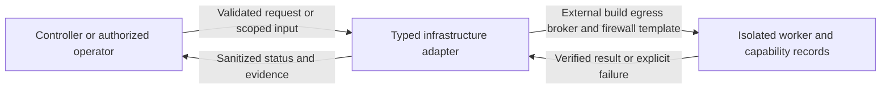
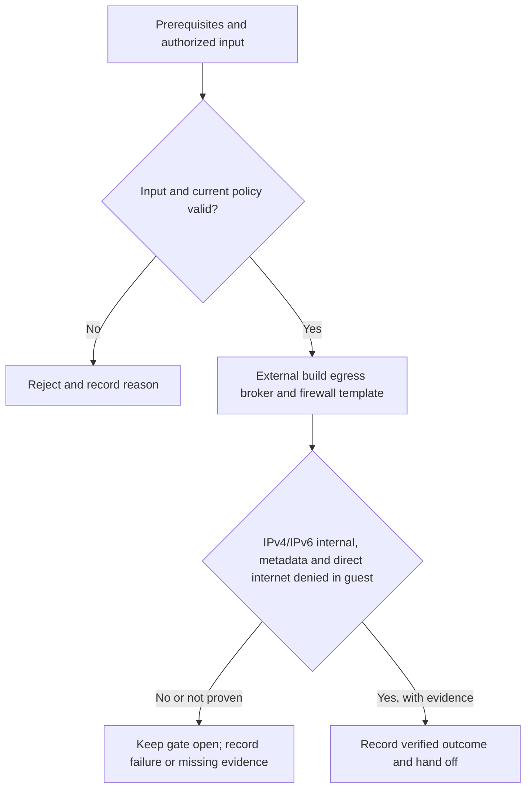

# P1-M05 - External build egress broker and firewall template

Track: **Minimal**. Design description; implementation and acceptance are not asserted here.

[Phase index](README.md) | [Project status](../../PROJECT-STATUS.md)

## What this milestone does

Lets builds reach approved public dependencies while preventing access to internal services, cloud metadata and unrestricted direct internet paths.

The deliverable is **External build egress broker and firewall template**. The observable completion condition is: iPv4/IPv6 internal, metadata and direct internet denied in guest.

## Scope and dependencies

- Prerequisites: [P1-M04](../PH1/p1-m04.md)
- Planning size: L; this is the source plan's relative estimate, not a delivery commitment.
- Phase context: An administrator submits an approved repository, follows an isolated build, and opens a healthy application through authenticated private ingress.
- Track boundary: minimal establishes the baseline; recommended and hardened extend it without removing earlier controls. Follow the source plan's imported prerequisites as well as the task dependencies above.

## Components and responsibilities

| Participant | Responsibility in this design view |
|---|---|
| Controller or authorized operator | Initiates the operation or supplies the scoped review input. |
| Typed infrastructure adapter | Owns validation and the milestone operation: External build egress broker and firewall template. |
| Isolated worker and capability records | Supplies protected state or records the verified outcome and supporting evidence. |

This is a logical responsibility drawing; arrows do not grant network access or define a new API. Concrete service boundaries and interfaces remain in the linked specifications.

## Functional flow

1. Confirm the prerequisites and select the authorized application, identity, worker or review scope relevant to this milestone.
2. Validate the input and current policy before performing **external build egress broker and firewall template**.
3. Evaluate the result against the milestone gate: **IPv4/IPv6 internal, metadata and direct internet denied in guest**.
4. Return a clear outcome and record supporting evidence. An attempted operation is not equivalent to an accepted milestone.

## Technical behavior and failure handling

Pass bounded typed requests across the control boundary. Check worker identity, ownership, policy version and actual capabilities; keep untrusted workloads away from management sockets, keys and host paths.

Refuse unsupported capabilities or stale commands. Bound work by resource budgets and expiry; reconcile owned resources before capacity is reused.

Phase-wide boundary: Application requests pass through the authenticated edge; management never executes repository code. Builds receive no runtime secrets, and application containers expose no host ports.

These are explanatory design constraints. Do not infer new endpoint names, database tables or infrastructure permissions from the drawings; implementation must follow the authoritative contracts below.

## Acceptance and handoff

The source gate is: **IPv4/IPv6 internal, metadata and direct internet denied in guest**.

Review the successful path, the rejection path and interruption/retry behavior relevant to that gate. Infrastructure claims require evidence from the applicable real environment. UI behavior must be checked together with direct API denial where permissions apply. Record the environment, versions, execution date and evidence location; preserve SKIP and Not run outcomes separately from PASS.

Hand off the verified deliverable and its evidence to dependent milestones. Until the gate and required review are complete, the milestone remains unaccepted. This document does not change release status.

## Authoritative references

- [Task scope, prerequisites and gate](../../docs/plans/PH1/minimal.md)
- [Roadmap and cumulative track contract](../../docs/plans/master-roadmap.md)
- [Component boundaries, protocols, storage and secrets](../../docs/architecture/component-design.md)
- [API contracts](../../docs/project/specifications/api-design.md)
- [Testing strategy](../../docs/project/specifications/testing-strategy.md)
- [Requirement evidence and security test mapping](../../docs/project/requirement-evidence.md)
- [Milestone implementation and evidence](../../docs/project/PH1/P1M05/README.md)
