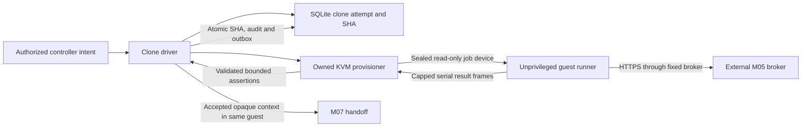

# P1-M06 — isolated bounded Git clone runner

Track: **Minimal**. Status: **Implemented/tested; isolated-KVM acceptance PASS** (2026-10-30).

[Phase index](README.md) | [Project status](../../PROJECT-STATUS.md) |
[Milestone implementation/evidence](../../docs/project/PH1/P1M06/README.md)

## Outcome and boundaries

A fresh pinned KVM guest fetches an approved credential-free HTTPS repository,
resolves the requested branch to an immutable SHA-1 commit, and exports a safe,
bounded tracked context without `.git`. The gate is **rebinding/helper/submodule/
redirect corpus denied, SHA recorded**. M05 supplies external egress enforcement;
M04 supplies the VM, quotas and independent expiry. M04 V14/V15 remain SKIP.

M06 does not run builds, ingest OCI artifacts, schedule full deployments, mediate
private Git credentials or enable production services. M07 consumes the accepted
context in the same guest; M12 owns complete scheduling/reservations and state
orchestration.

## Components and trust boundaries

The guest has no management network connection or host filesystem share. The
serial channel is bounded data, not an exec or filesystem API. Guest assertions
remain untrusted and cannot establish artifact safety.

- `internal/contracts/clone.go` defines strict bounded job/policy/result DTOs and
  shares URL/ref/path validation with deployment intent. The complete binding is
  job/deployment/lease, attempt, generation, deadline, template and policy hash.
- `internal/cloner` and `cmd/clone-runner` execute fixed Git argv inside the VM
  with a clean environment/HOME/config, approved HTTPS only, no prompts/helpers/
  hooks/filters/submodules, exact-SHA shallow fetch and bounded output/transfer.
- Tree/object inspection rejects unsupported modes/features, path collisions,
  metadata aliases, escaping or cyclic symlinks and context-rebasing escapes.
  Export preserves executable bits and safe internal links; config is a regular
  tracked file inside the selected context.
- `internal/provisioner/linux_clone_linux.go` validates the host binding and
  approved broker origins, seals a raw job memfd, attaches a read-only virtio
  device, and validates capped serial frames through owned journal/inode checks.
  Clone journals use `CloneVersion: 1`; unknown versions fail closed. No-clone
  journals and no-NIC mode remain supported.
- `internal/storage/clone.go` and migration 002 persist immutable SHA/attempt
  binding and transactionally write clone events, audit and a dedicated outbox.
  `internal/clonejob` gates handoff on durable accepted success and cleans up
  failures through the provisioner. Full scheduling remains outside this adapter.

## Limits, failure and recovery

The initial policy uses five minutes, 1 GiB context, 256 MiB encrypted transfer,
64 MiB individual expanded objects, 2 GiB expanded objects, 100,000 objects and
50,000 tree entries. Exact maxima and all remaining limits are in the
[operator runbook](../../infra/clone/README.md). Operator policy and remaining
lease can impose stricter limits. No repository can increase budgets.

Resolution emits before fetching the pinned SHA. If a branch moves and that
object is unavailable, deny while retaining the original SHA. A late/wrong-lease,
wrong-generation or conflicting reply cannot overwrite deployment history.
Cancellation and failure never publish a usable context. Hard VM expiry remains
independent of controller and guest/broker supervisors. Cleanup must confirm
owned VM, broker, network and disk absence before reserved capacity is released.
Foreign resources and uncertain ownership remain quarantined.

A failed source parser is contained in the VM. Streaming output cannot bypass
caps through an inherited buffer method. Broker DNS names are absolute, with
strict resolver errors and no search-suffix fallback; validated numeric addresses
are still pinned and upstream certificates independently verified.

## Packaging, migration and validation

`infra/builder/build-lab-fixture.sh clone` builds the reproducible pinned fixture
from installed trusted tools/kernel and the public build CA. A package manifest
and binary/image hashes are retained. Test init drops to UID/GID 1000, injects
poisoned Git settings and validates execution sentinels/context behavior.

`infra/clone/fixture.py` constructs known object/pack bytes without invoking Git
or parsing source on the host. Only disposable guests run the untrusted parser.
`infra/clone/lab.py` extends the existing isolated M05 lab with separate state,
controlled HTTPS/DNS/canaries, captures and cleanup checks. It refuses acceptance
for a subset, missing tests, SKIPs, source changes or incomplete cleanup.

Existing metadata databases require an explicit offline verified snapshot and
migration through `cmd/metadata-upgrade`; startup still refuses automatic
existing-data upgrades. The old state-transition outbox contract remains intact;
future dispatchers must consume the clone outbox as well.

All 83 required cases passed, including 51 actual Git cases and the M05 controlled
network regression. Final inventory confirmed 67 owned jobs cleaned up. The
[acceptance report](../../docs/project/PH1/P1M06/testing/acceptance-report.md) records
the frozen-source run and zero forbidden arrivals/search-suffix queries.

Actual results are recorded in the milestone's
[post-implementation test plan](../../docs/project/PH1/P1M06/test-plan.md) and
[implementation evidence](../../docs/project/PH1/P1M06/implementation-evidence.md).
Acceptance requires every mandatory case PASS, including real-host SEC-07 and
lifecycle evidence; a successful clone or software-only check is insufficient.

## Authoritative references

- [Source phase scope and gate](../../docs/plans/PH1/minimal.md)
- [Secure Git/build pipeline](../../docs/architecture/git-deployment-pipeline.md)
- [Shared clone-worker contract](../../docs/project/specifications/clone-runner.md)
- [Build-worker lifecycle](../../docs/project/specifications/deployment-agent.md)
- [Testing strategy](../../docs/project/specifications/testing-strategy.md)
- [Requirement evidence](../../docs/project/requirement-evidence.md)
