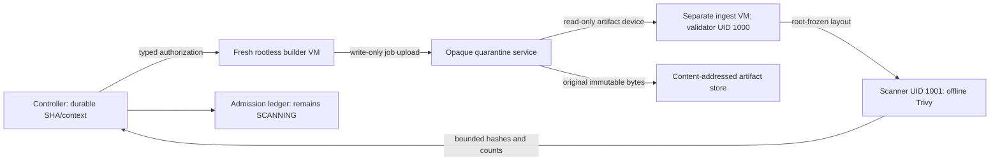

# P1-M07 — Rootless build and isolated artifact admission

Status: **Implemented/tested; isolated-KVM acceptance PASS** on 2026-10-30. All 146 required ledger cases in the
[post-implementation test plan](../../docs/project/PH1/P1M07/test-plan.md) passed; see the
[acceptance report](../../docs/project/PH1/P1M07/testing/acceptance-report.md).

## Trust boundaries

`internal/contracts` binds clone/build settings, egress policy, SHA/context,
attempt/generation/lease, upload, tool/database identity and artifact policy.
`internal/buildjob` owns the narrow handoff/scan workflow and recovery adapter.
M12 remains responsible for scheduling/reservations and deployment approval.

`internal/builder` uses a pinned built-in frontend, fixed source policy and
rootless BuildKit with process sandboxing. Initial build steps are offline;
registry pulls/upload use M05 mediation. Guest root compromise remains assumed
possible, so no result establishes trustworthy source provenance by self-report.

`internal/artifacts` accepts opaque bounded bytes behind a separate TLS listener
and private Unix control socket. Grants are scoped, hashed and revoked on service
restart. Quarantine and admitted storage have fixed capacities; artifact writes
preserve a management free-space reserve. Promotion publishes only fsynced,
rehashed original bytes, never scanner scratch or a guest-selected host path.

`internal/ingest` validates tar/OCI/layer semantics and digest/diff-ID graphs in the
VM. Malformed input never reaches scanning. Trusted guest init kills validator
descendants and freezes its output before scanner execution under another UID.
The validator cannot write the result serial channel. Scanner output is bounded,
normalized and denied for incomplete/stale coverage or HIGH/CRITICAL findings
without exact expiring exceptions.

Provisioner journals record inode/filesystem ownership of authorization/result
resources and distinct ingest machine identities. The host CLOCK_BOOTTIME timer
is rearmed before build dispatch, including when the guest refuses input. Ingest
has its own externally bounded lease and no network. Exact-binding reconciliation
cleans prior scanner attempts and preserves foreign resources.

Migration 003 stores immutable build attempts/results, events/audit and a separate
build outbox. Admission does not transition to APPROVED. A completed blob without
a committed admission is never deployable. Resume reruns verification/scanning;
missing upload-service state fails closed. Existing DBs require the verified
snapshot-and-upgrade workflow.

Authoritative details: [shared contract](../../docs/project/specifications/build-ingest.md),
[build runbook](../../infra/build/README.md),
[ingest runbook](../../infra/ingest/README.md),
[implementation plan](../../docs/project/PH1/P1M07/implementation-plan.md).
