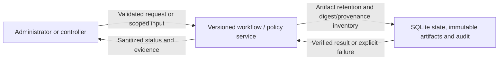
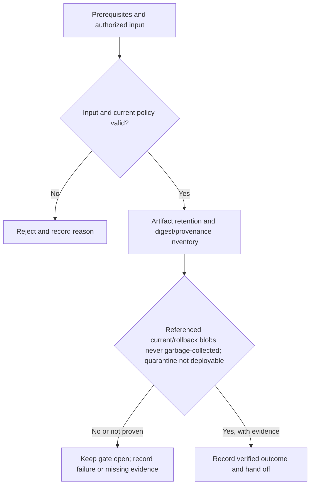

# P1-R04 - Artifact retention and digest/provenance inventory

Track: **Recommended**. Design description; implementation and acceptance are not asserted here.

[Phase index](README.md) | [Project status](../../PROJECT-STATUS.md)

## What this milestone does

This recommended addition provides artifact retention and digest/provenance inventory. It extends the phase outcome: an administrator submits an approved repository, follows an isolated build, and opens a healthy application through authenticated private ingress.

The deliverable is **Artifact retention and digest/provenance inventory**. The observable completion condition is: referenced current/rollback blobs never garbage-collected; quarantine not deployable.

## Scope and dependencies

- Prerequisites: [P1-M14](../PH1/p1-m14.md)
- Planning size: M; this is the source plan's relative estimate, not a delivery commitment.
- Phase context: An administrator submits an approved repository, follows an isolated build, and opens a healthy application through authenticated private ingress.
- Track boundary: minimal establishes the baseline; recommended and hardened extend it without removing earlier controls. Follow the source plan's imported prerequisites as well as the task dependencies above.

## Components and responsibilities

| Participant | Responsibility in this design view |
|---|---|
| Administrator or controller | Initiates the operation or supplies the scoped review input. |
| Versioned workflow / policy service | Owns validation and the milestone operation: Artifact retention and digest/provenance inventory. |
| SQLite state, immutable artifacts and audit | Supplies protected state or records the verified outcome and supporting evidence. |

This is a logical responsibility drawing; arrows do not grant network access or define a new API. Concrete service boundaries and interfaces remain in the linked specifications.

## Functional flow

1. Confirm the prerequisites and select the authorized application, identity, worker or review scope relevant to this milestone.
2. Validate the input and current policy before performing **artifact retention and digest/provenance inventory**.
3. Evaluate the result against the milestone gate: **Referenced current/rollback blobs never garbage-collected; quarantine not deployable**.
4. Return a clear outcome and record supporting evidence. An attempted operation is not equivalent to an accepted milestone.

## Technical behavior and failure handling

Validate the request against the authoritative schema and current policy. Persist durable intent before external side effects, use stable identities and generations, and return a bounded result that can be reconciled after interruption.

Reject invalid or stale input. Preserve the last verified state on failure and record enough sanitized evidence for safe retry and operator diagnosis.

Phase-wide boundary: Application requests pass through the authenticated edge; management never executes repository code. Builds receive no runtime secrets, and application containers expose no host ports.

These are explanatory design constraints. Do not infer new endpoint names, database tables or infrastructure permissions from the drawings; implementation must follow the authoritative contracts below.

## Acceptance and handoff

The source gate is: **Referenced current/rollback blobs never garbage-collected; quarantine not deployable**.

Review the successful path, the rejection path and interruption/retry behavior relevant to that gate. Infrastructure claims require evidence from the applicable real environment. UI behavior must be checked together with direct API denial where permissions apply. Record the environment, versions, execution date and evidence location; preserve SKIP and Not run outcomes separately from PASS.

Hand off the verified deliverable and its evidence to dependent milestones. Until the gate and required review are complete, the milestone remains unaccepted. This document does not change release status.

## Authoritative references

- [Task scope, prerequisites and gate](../../docs/plans/PH1/recommended.md)
- [Roadmap and cumulative track contract](../../docs/plans/master-roadmap.md)
- [Component boundaries, protocols, storage and secrets](../../docs/architecture/component-design.md)
- [API contracts](../../docs/project/specifications/api-design.md)
- [Testing strategy](../../docs/project/specifications/testing-strategy.md)
- [Requirement evidence and security test mapping](../../docs/project/requirement-evidence.md)
