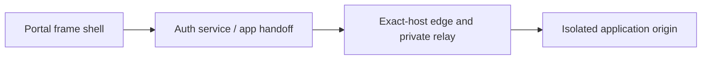

# PH2 - Embedded applications and routing

A user opens an allowed application while keeping the portal sidebar, or receives a protected new-tab fallback when embedding is incompatible.

These documents explain planned design and acceptance. Current implementation and test results remain in the [project status](../../PROJECT-STATUS.md) and linked milestone evidence.

The drawing is a responsibility overview, not a network connectivity or deployment topology.

## Minimal track

Source: [minimal plan](../../docs/plans/PH2/minimal.md). Recommended adds to minimal; hardened adds to both. Follow explicit cross-track dependencies.

| Milestone | Feature |
|---|---|
| [P2-M01](p2-m01.md) | App-origin inventory, exact host ownership and local hosts/CA setup contract |
| [P2-M02](p2-m02.md) | Audience/nonce-bound one-use handoff and app gateway sessions |
| [P2-M03](p2-m03.md) | Frame shell with CSP, sandbox and explicit protected-tab fallback |
| [P2-M04](p2-m04.md) | Authenticated WS relay with periodic lease and connection registry |
| [P2-M05](p2-m05.md) | Automated versioned route create/disable/rollback and probe reports |
| [P2-M06](p2-m06.md) | Browser compatibility harness for XFO/CSP/cookies/storage/redirects |

## Recommended track

Source: [recommended plan](../../docs/plans/PH2/recommended.md). Recommended adds to minimal; hardened adds to both. Follow explicit cross-track dependencies.

| Milestone | Feature |
|---|---|
| [P2-R01](p2-r01.md) | Header/URL/browser preflight report and admin compatibility approval |
| [P2-R02](p2-r02.md) | Domain ownership and certificate lifecycle adapter |
| [P2-R03](p2-r03.md) | SSE/download revocation and bounded in-flight response handling |
| [P2-R04](p2-r04.md) | Exact-origin postMessage API for harmless resize/status only |
| [P2-R05](p2-r05.md) | Full browser compatibility and route/certificate failure matrix |

## Hardened track

Source: [hardened plan](../../docs/plans/PH2/hardened.md). Recommended adds to minimal; hardened adds to both. Follow explicit cross-track dependencies.

| Milestone | Feature |
|---|---|
| [P2-H01](p2-h01.md) | Separate edge VM/service identity and minimal management auth channel |
| [P2-H02](p2-h02.md) | Cookie/domain adversarial suite with malicious app and nested frames |
| [P2-H03](p2-h03.md) | Bounded privacy-safe CSP violation collection and origin retirement process |
| [P2-H04](p2-h04.md) | Chaos routing/auth test campaign and independent browser review |
