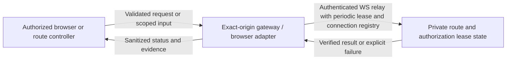
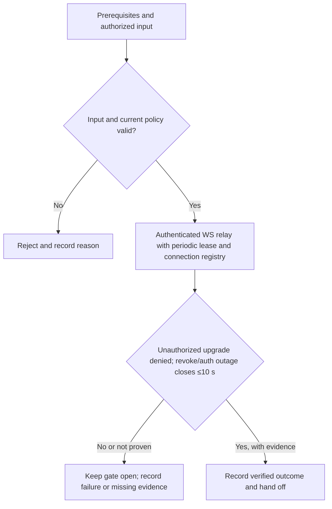

# P2-M04 - Authenticated WS relay with periodic lease and connection registry

Track: **Minimal**. Design description; implementation and acceptance are not asserted here.

[Phase index](README.md) | [Project status](../../PROJECT-STATUS.md)

## What this milestone does

Allows authorized live connections and closes them promptly when permission disappears or authorization cannot be renewed.

The deliverable is **Authenticated WS relay with periodic lease and connection registry**. The observable completion condition is: unauthorized upgrade denied; revoke/auth outage closes ≤10 s.

## Scope and dependencies

- Prerequisites: [P2-M02](../PH2/p2-m02.md)
- Planning size: L; this is the source plan's relative estimate, not a delivery commitment.
- Phase context: A user opens an allowed application while keeping the portal sidebar, or receives a protected new-tab fallback when embedding is incompatible.
- Track boundary: minimal establishes the baseline; recommended and hardened extend it without removing earlier controls. Follow the source plan's imported prerequisites as well as the task dependencies above.

## Components and responsibilities

| Participant | Responsibility in this design view |
|---|---|
| Authorized browser or route controller | Initiates the operation or supplies the scoped review input. |
| Exact-origin gateway / browser adapter | Owns validation and the milestone operation: Authenticated WS relay with periodic lease and connection registry. |
| Private route and authorization lease state | Supplies protected state or records the verified outcome and supporting evidence. |

This is a logical responsibility drawing; arrows do not grant network access or define a new API. Concrete service boundaries and interfaces remain in the linked specifications.

## Functional flow

1. Confirm the prerequisites and select the authorized application, identity, worker or review scope relevant to this milestone.
2. Validate the input and current policy before performing **authenticated WS relay with periodic lease and connection registry**.
3. Evaluate the result against the milestone gate: **Unauthorized upgrade denied; revoke/auth outage closes ≤10 s**.
4. Return a clear outcome and record supporting evidence. An attempted operation is not equivalent to an accepted milestone.

## Technical behavior and failure handling

Validate exact host or origin and current permission before forwarding or activation. Version route mutations, bound live authorization leases, and keep portal credentials away from upstream applications.

Deny unknown origins and expired authorization. Failed route changes retain the previous valid private configuration; unsupported framing uses the documented protected fallback.

Phase-wide boundary: Portal and application origins remain separate. Platform cookies are stripped upstream; incompatible frame policies are reported rather than removed. Authorization failure denies requests and expires stream leases.

These are explanatory design constraints. Do not infer new endpoint names, database tables or infrastructure permissions from the drawings; implementation must follow the authoritative contracts below.

## Acceptance and handoff

The source gate is: **Unauthorized upgrade denied; revoke/auth outage closes ≤10 s**.

Review the successful path, the rejection path and interruption/retry behavior relevant to that gate. Infrastructure claims require evidence from the applicable real environment. UI behavior must be checked together with direct API denial where permissions apply. Record the environment, versions, execution date and evidence location; preserve SKIP and Not run outcomes separately from PASS.

Hand off the verified deliverable and its evidence to dependent milestones. Until the gate and required review are complete, the milestone remains unaccepted. This document does not change release status.

## Authoritative references

- [Task scope, prerequisites and gate](../../docs/plans/PH2/minimal.md)
- [Roadmap and cumulative track contract](../../docs/plans/master-roadmap.md)
- [Component boundaries, protocols, storage and secrets](../../docs/architecture/component-design.md)
- [API contracts](../../docs/project/specifications/api-design.md)
- [Testing strategy](../../docs/project/specifications/testing-strategy.md)
- [Requirement evidence and security test mapping](../../docs/project/requirement-evidence.md)
