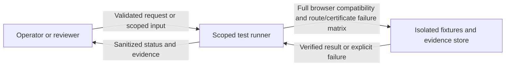
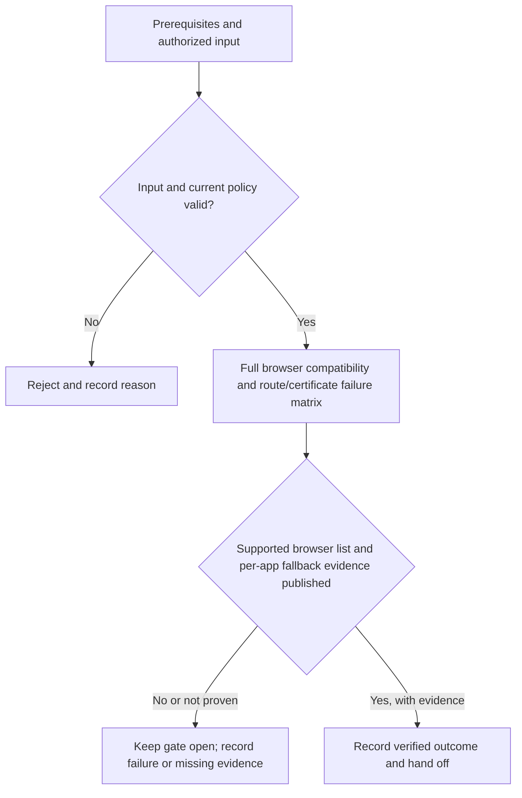

# P2-R05 - Full browser compatibility and route/certificate failure matrix

Track: **Recommended**. Design description; implementation and acceptance are not asserted here.

[Phase index](README.md) | [Project status](../../PROJECT-STATUS.md)

## What this milestone does

This recommended addition provides full browser compatibility and route/certificate failure matrix. It extends the phase outcome: a user opens an allowed application while keeping the portal sidebar, or receives a protected new-tab fallback when embedding is incompatible.

The deliverable is **Full browser compatibility and route/certificate failure matrix**. The observable completion condition is: supported browser list and per-app fallback evidence published.

## Scope and dependencies

- Prerequisites: [P2-R02](../PH2/p2-r02.md), [P2-R03](../PH2/p2-r03.md), [P2-R04](../PH2/p2-r04.md)
- Planning size: M; this is the source plan's relative estimate, not a delivery commitment.
- Phase context: A user opens an allowed application while keeping the portal sidebar, or receives a protected new-tab fallback when embedding is incompatible.
- Track boundary: minimal establishes the baseline; recommended and hardened extend it without removing earlier controls. Follow the source plan's imported prerequisites as well as the task dependencies above.

## Components and responsibilities

| Participant | Responsibility in this design view |
|---|---|
| Operator or reviewer | Initiates the operation or supplies the scoped review input. |
| Scoped test runner | Owns validation and the milestone operation: Full browser compatibility and route/certificate failure matrix. |
| Isolated fixtures and evidence store | Supplies protected state or records the verified outcome and supporting evidence. |

This is a logical responsibility drawing; arrows do not grant network access or define a new API. Concrete service boundaries and interfaces remain in the linked specifications.

## Functional flow

1. Confirm the prerequisites and select the authorized application, identity, worker or review scope relevant to this milestone.
2. Validate the input and current policy before performing **full browser compatibility and route/certificate failure matrix**.
3. Evaluate the result against the milestone gate: **Supported browser list and per-app fallback evidence published**.
4. Return a clear outcome and record supporting evidence. An attempted operation is not equivalent to an accepted milestone.

## Technical behavior and failure handling

Execute success, denial, race and outage cases in the environment required by the source gate. Record versions and PASS, FAIL, SKIP or Not run separately; a model test cannot prove a real host boundary.

A failure produces a reproducible finding and blocks the affected gate until remediation is verified.

Phase-wide boundary: Portal and application origins remain separate. Platform cookies are stripped upstream; incompatible frame policies are reported rather than removed. Authorization failure denies requests and expires stream leases.

These are explanatory design constraints. Do not infer new endpoint names, database tables or infrastructure permissions from the drawings; implementation must follow the authoritative contracts below.

## Acceptance and handoff

The source gate is: **Supported browser list and per-app fallback evidence published**.

Review the successful path, the rejection path and interruption/retry behavior relevant to that gate. Infrastructure claims require evidence from the applicable real environment. UI behavior must be checked together with direct API denial where permissions apply. Record the environment, versions, execution date and evidence location; preserve SKIP and Not run outcomes separately from PASS.

Hand off the verified deliverable and its evidence to dependent milestones. Until the gate and required review are complete, the milestone remains unaccepted. This document does not change release status.

## Authoritative references

- [Task scope, prerequisites and gate](../../docs/plans/PH2/recommended.md)
- [Roadmap and cumulative track contract](../../docs/plans/master-roadmap.md)
- [Component boundaries, protocols, storage and secrets](../../docs/architecture/component-design.md)
- [API contracts](../../docs/project/specifications/api-design.md)
- [Testing strategy](../../docs/project/specifications/testing-strategy.md)
- [Requirement evidence and security test mapping](../../docs/project/requirement-evidence.md)
