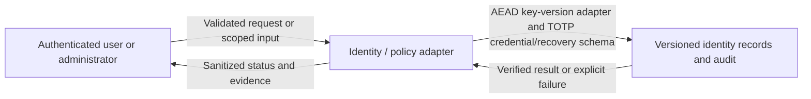
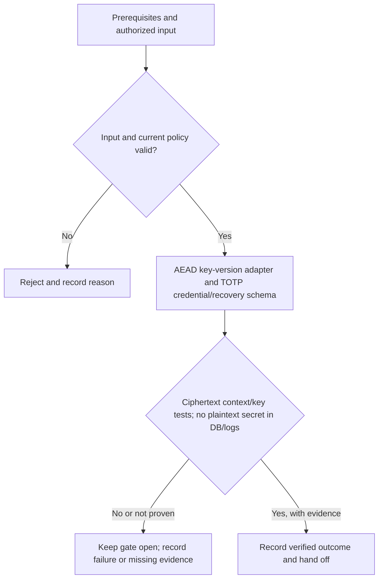

# P3-M01 - AEAD key-version adapter and TOTP credential/recovery schema

Track: **Minimal**. Design description; implementation and acceptance are not asserted here.

[Phase index](README.md) | [Project status](../../PROJECT-STATUS.md)

## What this milestone does

Stores MFA credentials in a form that a database copy alone cannot reveal and prepares safe key-version handling.

The deliverable is **AEAD key-version adapter and TOTP credential/recovery schema**. The observable completion condition is: ciphertext context/key tests; no plaintext secret in DB/logs.

## Scope and dependencies

- Prerequisites: [P1-M03](../PH1/p1-m03.md)
- Planning size: M; this is the source plan's relative estimate, not a delivery commitment.
- Phase context: An administrator enrolls MFA and manages accounts and explicit application grants; users see and open only applications they are allowed to access.
- Track boundary: minimal establishes the baseline; recommended and hardened extend it without removing earlier controls. Follow the source plan's imported prerequisites as well as the task dependencies above.

## Components and responsibilities

| Participant | Responsibility in this design view |
|---|---|
| Authenticated user or administrator | Initiates the operation or supplies the scoped review input. |
| Identity / policy adapter | Owns validation and the milestone operation: AEAD key-version adapter and TOTP credential/recovery schema. |
| Versioned identity records and audit | Supplies protected state or records the verified outcome and supporting evidence. |

This is a logical responsibility drawing; arrows do not grant network access or define a new API. Concrete service boundaries and interfaces remain in the linked specifications.

## Functional flow

1. Confirm the prerequisites and select the authorized application, identity, worker or review scope relevant to this milestone.
2. Validate the input and current policy before performing **aEAD key-version adapter and TOTP credential/recovery schema**.
3. Evaluate the result against the milestone gate: **Ciphertext context/key tests; no plaintext secret in DB/logs**.
4. Return a clear outcome and record supporting evidence. An attempted operation is not equivalent to an accepted milestone.

## Technical behavior and failure handling

Validate identity, role, context and expiry before changing protected state. Bind secret material to authenticated context, persist state changes atomically where applicable, and expose references or sanitized results to callers.

Deny expired, replayed or wrong-context inputs. Service or key failure must not bypass authentication; committed revocation must remain effective during retries.

Phase-wide boundary: TOTP secrets use versioned authenticated encryption with keys outside SQLite. Pending login grants no application access. Recovery codes are one-use; committed revocations must reach HTTP within 5 seconds and streams within 10 seconds.

These are explanatory design constraints. Do not infer new endpoint names, database tables or infrastructure permissions from the drawings; implementation must follow the authoritative contracts below.

## Acceptance and handoff

The source gate is: **Ciphertext context/key tests; no plaintext secret in DB/logs**.

Review the successful path, the rejection path and interruption/retry behavior relevant to that gate. Infrastructure claims require evidence from the applicable real environment. UI behavior must be checked together with direct API denial where permissions apply. Record the environment, versions, execution date and evidence location; preserve SKIP and Not run outcomes separately from PASS.

Hand off the verified deliverable and its evidence to dependent milestones. Until the gate and required review are complete, the milestone remains unaccepted. This document does not change release status.

## Authoritative references

- [Task scope, prerequisites and gate](../../docs/plans/PH3/minimal.md)
- [Roadmap and cumulative track contract](../../docs/plans/master-roadmap.md)
- [Component boundaries, protocols, storage and secrets](../../docs/architecture/component-design.md)
- [API contracts](../../docs/project/specifications/api-design.md)
- [Testing strategy](../../docs/project/specifications/testing-strategy.md)
- [Requirement evidence and security test mapping](../../docs/project/requirement-evidence.md)
