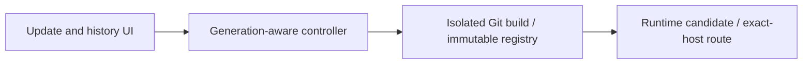

# PH4 - Git updates and safe rollback

An administrator compares commits, builds an update, checks its health, and switches traffic or requests a compatible rollback with an auditable history.

These documents explain planned design and acceptance. Current implementation and test results remain in the [project status](../../PROJECT-STATUS.md) and linked milestone evidence.

The drawing is a responsibility overview, not a network connectivity or deployment topology.

## Minimal track

Source: [minimal plan](../../docs/plans/PH4/minimal.md). Recommended adds to minimal; hardened adds to both. Follow explicit cross-track dependencies.

| Milestone | Feature |
|---|---|
| [P4-M01](p4-m01.md) | Bounded isolated branch observation and commit comparison |
| [P4-M02](p4-m02.md) | New deployment intent from selected immutable SHA and prior spec |
| [P4-M03](p4-m03.md) | Per-app generation lock, private candidate and health-gated cutover |
| [P4-M04](p4-m04.md) | Retained approved digest/spec rollback and compatibility preflight |
| [P4-M05](p4-m05.md) | History/update/rollback UI with explicit data-risk confirmation |
| [P4-M06](p4-m06.md) | Fault matrix for image pull/health/route switch/controller restart |

## Recommended track

Source: [recommended plan](../../docs/plans/PH4/recommended.md). Recommended adds to minimal; hardened adds to both. Follow explicit cross-track dependencies.

| Milestone | Feature |
|---|---|
| [P4-R01](p4-r01.md) | Scheduled branch observation and explicit update notifications |
| [P4-R02](p4-r02.md) | Provider-specific signed webhook verification and replay store |
| [P4-R03](p4-r03.md) | Repo/ref mapping, queued trigger coalescing and admin opt-in policy |
| [P4-R04](p4-r04.md) | Pre-update app-consistent backup hook contract and restore preview |
| [P4-R05](p4-r05.md) | Delivery/update observability and webhook/rollback incident drill |

## Hardened track

Source: [hardened plan](../../docs/plans/PH4/hardened.md). Recommended adds to minimal; hardened adds to both. Follow explicit cross-track dependencies.

| Milestone | Feature |
|---|---|
| [P4-H01](p4-h01.md) | Controller-produced provenance schema and signing adapter |
| [P4-H02](p4-h02.md) | Agent verification of signature, digest and current revocation policy |
| [P4-H03](p4-h03.md) | Optional staged promotion and expiring second approval |
| [P4-H04](p4-h04.md) | Supply-chain compromise and data-compatible rollback exercise |
