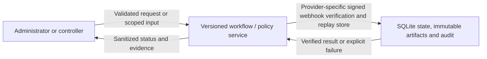
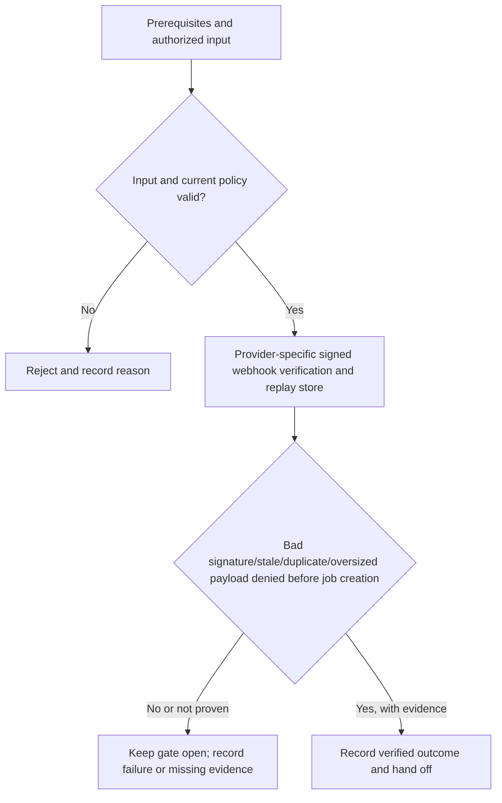

# P4-R02 - Provider-specific signed webhook verification and replay store

Track: **Recommended**. Design description; implementation and acceptance are not asserted here.

[Phase index](README.md) | [Project status](../../PROJECT-STATUS.md)

## What this milestone does

This recommended addition provides provider-specific signed webhook verification and replay store. It extends the phase outcome: an administrator compares commits, builds an update, checks its health, and switches traffic or requests a compatible rollback with an auditable history.

The deliverable is **Provider-specific signed webhook verification and replay store**. The observable completion condition is: bad signature/stale/duplicate/oversized payload denied before job creation.

## Scope and dependencies

- Prerequisites: [P4-M06](../PH4/p4-m06.md)
- Planning size: M; this is the source plan's relative estimate, not a delivery commitment.
- Phase context: An administrator compares commits, builds an update, checks its health, and switches traffic or requests a compatible rollback with an auditable history.
- Track boundary: minimal establishes the baseline; recommended and hardened extend it without removing earlier controls. Follow the source plan's imported prerequisites as well as the task dependencies above.

## Components and responsibilities

| Participant | Responsibility in this design view |
|---|---|
| Administrator or controller | Initiates the operation or supplies the scoped review input. |
| Versioned workflow / policy service | Owns validation and the milestone operation: Provider-specific signed webhook verification and replay store. |
| SQLite state, immutable artifacts and audit | Supplies protected state or records the verified outcome and supporting evidence. |

This is a logical responsibility drawing; arrows do not grant network access or define a new API. Concrete service boundaries and interfaces remain in the linked specifications.

## Functional flow

1. Confirm the prerequisites and select the authorized application, identity, worker or review scope relevant to this milestone.
2. Validate the input and current policy before performing **provider-specific signed webhook verification and replay store**.
3. Evaluate the result against the milestone gate: **Bad signature/stale/duplicate/oversized payload denied before job creation**.
4. Return a clear outcome and record supporting evidence. An attempted operation is not equivalent to an accepted milestone.

## Technical behavior and failure handling

Validate the request against the authoritative schema and current policy. Persist durable intent before external side effects, use stable identities and generations, and return a bounded result that can be reconciled after interruption.

Reject invalid or stale input. Preserve the last verified state on failure and record enough sanitized evidence for safe retry and operator diagnosis.

Phase-wide boundary: Runtime uses approved immutable digests and current policy. Per-app generations prevent stale work from activating. Code rollback does not restore application data; incompatible data changes must block automatic rollback.

These are explanatory design constraints. Do not infer new endpoint names, database tables or infrastructure permissions from the drawings; implementation must follow the authoritative contracts below.

## Acceptance and handoff

The source gate is: **Bad signature/stale/duplicate/oversized payload denied before job creation**.

Review the successful path, the rejection path and interruption/retry behavior relevant to that gate. Infrastructure claims require evidence from the applicable real environment. UI behavior must be checked together with direct API denial where permissions apply. Record the environment, versions, execution date and evidence location; preserve SKIP and Not run outcomes separately from PASS.

Hand off the verified deliverable and its evidence to dependent milestones. Until the gate and required review are complete, the milestone remains unaccepted. This document does not change release status.

## Authoritative references

- [Task scope, prerequisites and gate](../../docs/plans/PH4/recommended.md)
- [Roadmap and cumulative track contract](../../docs/plans/master-roadmap.md)
- [Component boundaries, protocols, storage and secrets](../../docs/architecture/component-design.md)
- [API contracts](../../docs/project/specifications/api-design.md)
- [Testing strategy](../../docs/project/specifications/testing-strategy.md)
- [Requirement evidence and security test mapping](../../docs/project/requirement-evidence.md)
