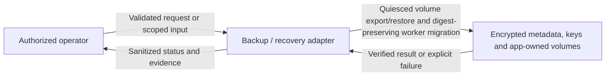
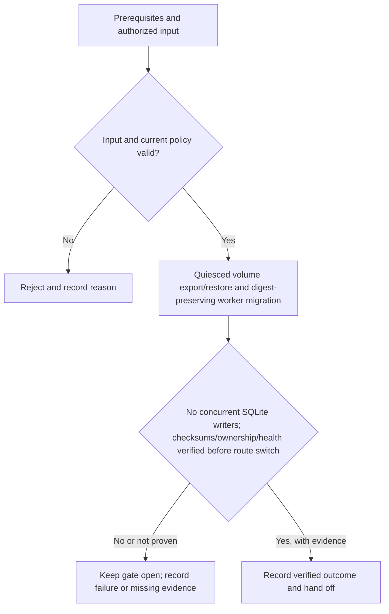

# P5-H03 - Quiesced volume export/restore and digest-preserving worker migration

Track: **Hardened**. Design description; implementation and acceptance are not asserted here.

[Phase index](README.md) | [Project status](../../PROJECT-STATUS.md)

## What this milestone does

This hardened addition provides quiesced volume export/restore and digest-preserving worker migration. It extends the phase outcome: operators detect deployment risks, rehearse recovery and containment, and release only with current evidence and assigned residual-risk owners.

The deliverable is **Quiesced volume export/restore and digest-preserving worker migration**. The observable completion condition is: no concurrent SQLite writers; checksums/ownership/health verified before route switch.

## Scope and dependencies

- Prerequisites: [P5-H02](../PH5/p5-h02.md)
- Planning size: L; this is the source plan's relative estimate, not a delivery commitment.
- Phase context: Operators detect deployment risks, rehearse recovery and containment, and release only with current evidence and assigned residual-risk owners.
- Track boundary: minimal establishes the baseline; recommended and hardened extend it without removing earlier controls. Follow the source plan's imported prerequisites as well as the task dependencies above.

## Components and responsibilities

| Participant | Responsibility in this design view |
|---|---|
| Authorized operator | Initiates the operation or supplies the scoped review input. |
| Backup / recovery adapter | Owns validation and the milestone operation: Quiesced volume export/restore and digest-preserving worker migration. |
| Encrypted metadata, keys and app-owned volumes | Supplies protected state or records the verified outcome and supporting evidence. |

This is a logical responsibility drawing; arrows do not grant network access or define a new API. Concrete service boundaries and interfaces remain in the linked specifications.

## Functional flow

1. Confirm the prerequisites and select the authorized application, identity, worker or review scope relevant to this milestone.
2. Validate the input and current policy before performing **quiesced volume export/restore and digest-preserving worker migration**.
3. Evaluate the result against the milestone gate: **No concurrent SQLite writers; checksums/ownership/health verified before route switch**.
4. Return a clear outcome and record supporting evidence. An attempted operation is not equivalent to an accepted milestone.

## Technical behavior and failure handling

Use the SQLite online backup contract and application-consistent volume capture. Keep wrapping keys separately protected; verify checksums, app ownership and health before restoring private routes.

Abort on missing keys, failed integrity or ownership checks. Preserve original data and keep restored routes denied until validation succeeds.

Phase-wide boundary: Security controls remain mandatory in earlier phases. Recovery verifies integrity, keys, volume ownership and private-route bootstrap. Unsupported checks and skipped tests remain explicit; evidence cannot establish untested isolation.

These are explanatory design constraints. Do not infer new endpoint names, database tables or infrastructure permissions from the drawings; implementation must follow the authoritative contracts below.

## Acceptance and handoff

The source gate is: **No concurrent SQLite writers; checksums/ownership/health verified before route switch**.

Review the successful path, the rejection path and interruption/retry behavior relevant to that gate. Infrastructure claims require evidence from the applicable real environment. UI behavior must be checked together with direct API denial where permissions apply. Record the environment, versions, execution date and evidence location; preserve SKIP and Not run outcomes separately from PASS.

Hand off the verified deliverable and its evidence to dependent milestones. Until the gate and required review are complete, the milestone remains unaccepted. This document does not change release status.

## Authoritative references

- [Task scope, prerequisites and gate](../../docs/plans/PH5/hardened.md)
- [Roadmap and cumulative track contract](../../docs/plans/master-roadmap.md)
- [Component boundaries, protocols, storage and secrets](../../docs/architecture/component-design.md)
- [API contracts](../../docs/project/specifications/api-design.md)
- [Testing strategy](../../docs/project/specifications/testing-strategy.md)
- [Requirement evidence and security test mapping](../../docs/project/requirement-evidence.md)
