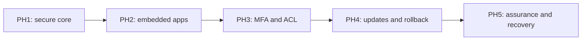

# Low-level design: milestone guide

This collection explains what every roadmap milestone does, why it matters, how its responsibilities fit together, and what must be demonstrated before acceptance. Functional descriptions are paired with technical boundaries and Mermaid architecture and flow diagrams.

Start with the phase index, then select a milestone. A document exists for every minimal, recommended and hardened task in the fifteen phase plans.

| Phase | Outcome | Milestones |
|---|---|---|
| [PH1 - Secure core](PH1/README.md) | An administrator submits an approved repository, follows an isolated build, and opens a healthy application through authenticated private ingress. | 25 |
| [PH2 - Embedded applications and routing](PH2/README.md) | A user opens an allowed application while keeping the portal sidebar, or receives a protected new-tab fallback when embedding is incompatible. | 15 |
| [PH3 - MFA, users and application permissions](PH3/README.md) | An administrator enrolls MFA and manages accounts and explicit application grants; users see and open only applications they are allowed to access. | 16 |
| [PH4 - Git updates and safe rollback](PH4/README.md) | An administrator compares commits, builds an update, checks its health, and switches traffic or requests a compatible rollback with an auditable history. | 15 |
| [PH5 - Security assurance and recovery](PH5/README.md) | Operators detect deployment risks, rehearse recovery and containment, and release only with current evidence and assigned residual-risk owners. | 16 |

## Reading the designs

- **Functional sections** explain the purpose and observable outcome for users or operators.
- **Technical sections** identify logical responsibilities, state boundaries, failure handling and source contracts. Diagrams are conceptual design views, not executable topology or new API specifications.
- **Acceptance sections** preserve the source task gate. Tests described here are required checks, not newly executed results.
- **Tracks are cumulative:** recommended imports minimal; hardened imports both. Explicit dependencies can cross phases or tracks. Optional features remain optional unless selected or required by a dependency.

The drawing shows the minimal phase sequence. Day-one MFA can bring P3-M01 through P3-M04 and their prerequisites into PH1 release scope; see the roadmap.

## Status and maintenance

The [phase plans](../docs/plans/master-roadmap.md) own scope and dependencies. [Project status](../PROJECT-STATUS.md) and [milestone evidence](../docs/project/progress.md) own implementation and acceptance records. This collection explains the design without replacing those sources. P1-M04 retains qualified acceptance: V14 and V15 are skipped.

When a milestone changes, update its explanatory document and diagrams alongside the authoritative plan or contract. Keep task IDs stable. Mermaid fences render in compatible Markdown viewers, including GitHub; raw text remains readable elsewhere.

[All documentation](../docs/README.md) | [Requirements](../docs/project/requirements.md) | [Architecture](../docs/architecture/recommended-architecture.md)
