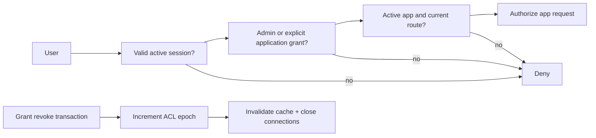

# Authentication and authorization

## Identity model

Roles: admin and user. Admin may manage users, repositories, jobs, app logs, infrastructure and ACL. User may only list/open explicitly assigned apps. Role checks happen in backend handlers and job submission, not just UI. Admin app access is an explicit documented policy (default all apps); disabled users have no access including admins. Service identities are separate from human users and cannot log in to portal.

PH1 ships single-admin setup and sessions with deny-by-default user policy. PH3 supplies full MFA/user/ACL administration. Production requiring MFA cannot release password-only PH1 without pulling those tasks forward.

## Password and setup

Argon2id with unique salt and versioned parameters; initial profile 64 MiB, 3 iterations, parallelism 1, benchmark to ~100–500 ms on target and cap concurrent hashes. Permit long passwords; do not silently truncate. Deny common/compromised passwords using local list. Constant-time comparison and generic failures avoid user enumeration.

Initial setup is disabled after first admin transaction. Operator supplies expiring one-time setup token out of band; bootstrap listener is loopback/operator tunnel only until TLS configured. Never ship default passwords. Rate-limit login by account and IP with bounded backoff and audit, without permanent attacker-triggered account lockout.

## Sessions and CSRF

Store only hash of random 256-bit session token. `__Host-portal_session`: Secure, HttpOnly, Path=/, no Domain, SameSite=Lax. Rotate at login, MFA completion and privilege change; 30-minute idle and 12-hour absolute expiry initially, with reauthentication for user/ACL/secret/infrastructure changes. Server-side revocation and session listing. Never store auth tokens in localStorage.

CSRF tokens tied to server session on all mutating browser requests, Origin validation, safe GET semantics. CORS is default deny; CORS is not CSRF protection. App gateway has separate session cookie and does not forward platform cookies or trusted identity headers blindly to workloads.

## TOTP and recovery (PH3)

Enroll only after recent password authentication; generate 160-bit random secret, encrypted at rest with versioned AEAD key outside DB. Standard 30-second period, narrow ±1 step skew; persist last accepted step to prevent reuse, including concurrent verification. Confirm two-step enrollment before activation; do not log QR/secret. Pending login session cannot access any protected operation.

Recovery codes: 10 random high-entropy codes, displayed once, separately hashed, single-use transactional consumption, rate-limited and audited; regenerate invalidates all old codes. MFA reset requires recent MFA/recovery proof or documented offline operator recovery with audit and all-session revocation. Do not reset solely by email. Require MFA for admins once full feature is released; enrolling first admin is a guarded setup flow.

## ACL and revocation

`application_permissions(user_id, application_id, permission=access)` unique pair. No implied category inheritance initially. Catalog and launch are conveniences; API/gateway independently authorize every app request. Unauthorized resource IDs return non-enumerating responses. App authorization is not app-internal business-role authorization; forwarded identity is opt-in and app-specific.

Phase-one HTTP auth has no positive authorization cache. Later max positive TTL 5 seconds with ACL/user epochs, push invalidation and strict maximum lease; deny cache ≤1 second to reduce surprising grants. A committed revoke must block new HTTP requests within 5 seconds (PH1 immediate DB check); WS and SSE are terminated within 10 seconds, even if push delivery fails. Loss of authorization connectivity expires leases and denies traffic, not stale indefinite allow.

Already delivered data cannot be revoked. In-flight HTTP responses are aborted where possible; hard connection/body duration limits bound streaming exposure. Relay tracks streams by session and user/app IDs, including SSE and downloads. Control requests carry monotonic ACL version so stale cache fills cannot resurrect revoked access.

## Audit and tests

Audit login/logout, setup, MFA changes/recovery, sessions revoked, role/ACL changes, launch denial, sensitive reads, secret changes, deploy/stop/delete and agent enrollment. Never record passwords, tokens, TOTP values or raw headers. Immutable actor IDs and correlation IDs; external append-only export long term.

Tests: every endpoint role matrix, direct URL and forged headers, IDOR, login CSRF, session fixation, parallel recovery use, TOTP replay, disabled admin, stale cache race, offline auth service, revoked open WebSocket/SSE. Time revocation from DB commit, not UI click.
