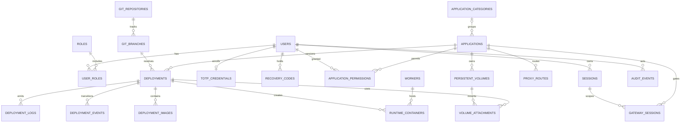

# SQLite metadata design

Use one SQLite DB owned solely by API/controller service in management VM, not a shared NFS/SMB file. Foreign keys ON on every connection; WAL, busy timeout 5 s, short transactions, single serialized writer queue initially. Never keep transactions open during builds/network calls. Read-only pools for UI; bounded log ingestion/outbox batching. SQLite is appropriate for a small single-controller platform; sustained write contention, not worker count alone, triggers a future DB migration.

UUID/ULID IDs, UTC timestamps, integer versions for compare-and-swap. SQL constraints validate enums, ownership and uniqueness; service validation remains required. JSON fields contain versioned normalized specs, never opaque trusted Compose. Secrets use ciphertext/key references, not plain JSON.

## Tables and constraints

| Table | Key columns / relationships / indexes |
|---|---|
| users | id PK, username unique normalized, password_hash, disabled_at, auth_epoch, timestamps |
| roles | id PK, name unique (`admin`,`user`) |
| user_roles | user_id/role_id composite PK; FKs, role lookup index |
| sessions | id PK, token_hash unique, user_id FK, kind, mfa_level, idle/absolute expiry, revoked_at, auth_epoch; user/expiry indexes |
| totp_credentials | user_id PK/FK, encrypted_secret, key_version, confirmed_at, last_used_step |
| recovery_codes | id PK, user_id FK, code_hash, consumed_at; user index |
| application_categories | id PK, label, sort_order; no ACL inheritance |
| applications | id PK, slug unique, display_name, category_id FK nullable, owner_id FK, state, active_deployment_id nullable FK, acl_epoch, version |
| application_permissions | user_id/application_id composite PK, permission CHECK access, granted_by FK, timestamps; application index |
| git_repositories | id PK, canonical_url, credential_ref nullable, allowed_origin, owner_id FK |
| git_branches | id PK, repository_id FK, ref_name, last_observed_sha, checked_at; unique(repo, ref) |
| deployments | id PK, app_id FK, branch_id FK, submitted_by FK, commit_sha, state, image_digest, spec_json/hash, policy_version, generation, previous_id FK, failure_code, deadlines; app/time and state/deadline indexes |
| deployment_events | id PK, deployment_id FK, sequence unique per deployment, transition/reason, timestamp |
| deployment_logs | deployment_id/sequence composite PK, timestamp, stream, sanitized_chunk; size/retention bounded |
| workers | id PK, role, identity_fingerprint, capabilities, lease, revoked_at |
| runtime_containers | id PK, deployment_id/app_id/worker_id FKs, engine_id unique per worker, service_name, desired/observed state, generation |
| proxy_routes | id PK, app_id/deployment_id FKs, canonical_host unique, backend_handle, active_generation, desired_generation, state; no freeform proxy config |
| persistent_volumes | id PK, app_id/worker_id FKs, quota_bytes, mount_target, uid/gid, state, backup_policy; app index |
| volume_attachments | volume_id/deployment_id/service composite PK, mount_target, mode; enforce same app in service transaction/agent |
| secret_references | id PK, app_id nullable FK, purpose, ciphertext/key_version, current_version; no values in audit |
| audit_events | id PK, actor kind/id, action, target type/id, result, correlation_id, sanitized_metadata, timestamp; time/actor/target indexes |
| job_leases | deployment_id PK/FK, worker_id FK, expires_at, generation; expiry index |
| launch_handles | token_hash PK, session_id/app_id FKs, nonce_hash, expires_at, consumed_at |
| gateway_sessions | token_hash PK, session_id/app_id FKs, auth/acl epochs, expires_at, revoked_at |
| policy_exceptions | id PK, app_id FK, control, scope, approver FK, expires_at, decision_hash |
| outbox | id PK, event_type, aggregate_id, payload, delivered_at; pending index |
| schema_migrations | version PK, checksum, applied_at |

Deployments with multiple services also use `deployment_images(deployment_id, service_name, digest)`; root `image_digest` is optional convenience for Dockerfile deployments. Approved spec references every immutable service digest. Append-only provenance includes source SHA, builder template, scanner version/database timestamp and policy hash; it is controller-produced, not a repository-supplied attestation.

## ERD

## Migrations and deletion

Numbered transactional SQL migrations, checksums, exclusive startup migration lock, snapshot before upgrade and migration compatibility check. Never silently downgrade schema. Expand/contract changes for future rolling upgrades. RESTRICT deletion of active deployments, volumes and referenced artifacts. Soft-delete app/user identity while retaining audit; cascade only safe ephemeral sessions/handles. Avoid mutable username as audit identity. DB consistency checks cover app/volume ownership across FKs where composite constraints are impractical.

## Backup/concurrency tests

Online SQLite backup API and integrity/foreign_key checks, encrypted off-host copy, separate key backup, restore to isolated environment with routes initially disabled. Test WAL checkpoint pressure, log floods, concurrent deploy/cancel/revoke and power loss. Each application's own SQLite files live on that app's managed volume, owned by that app and one active writer topology; the platform metadata DB is never mounted into applications.
