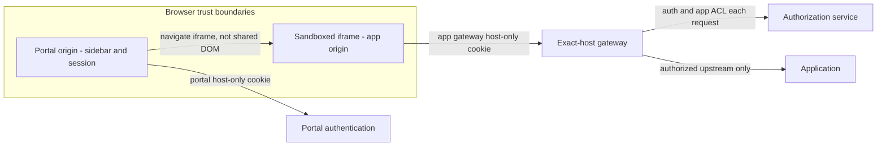
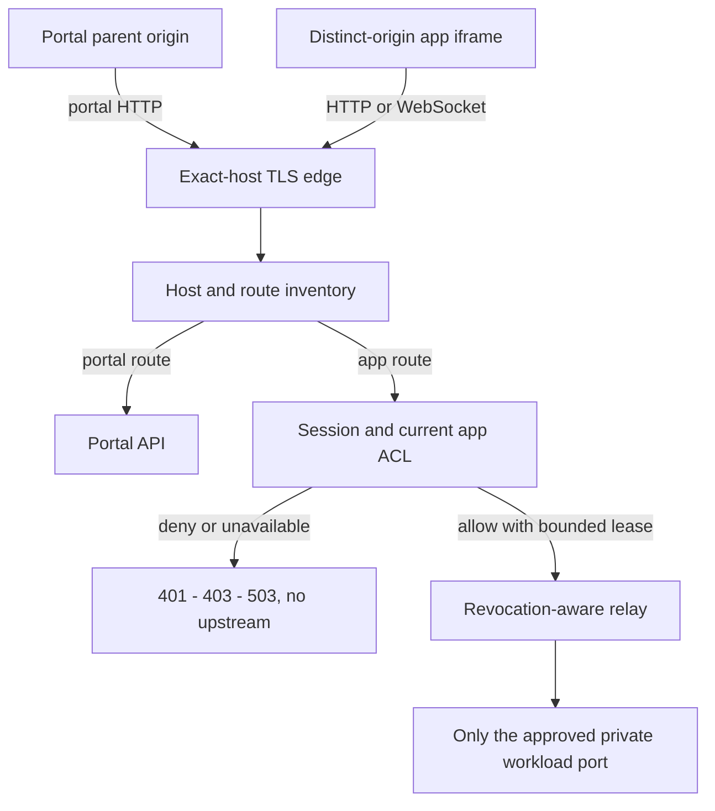
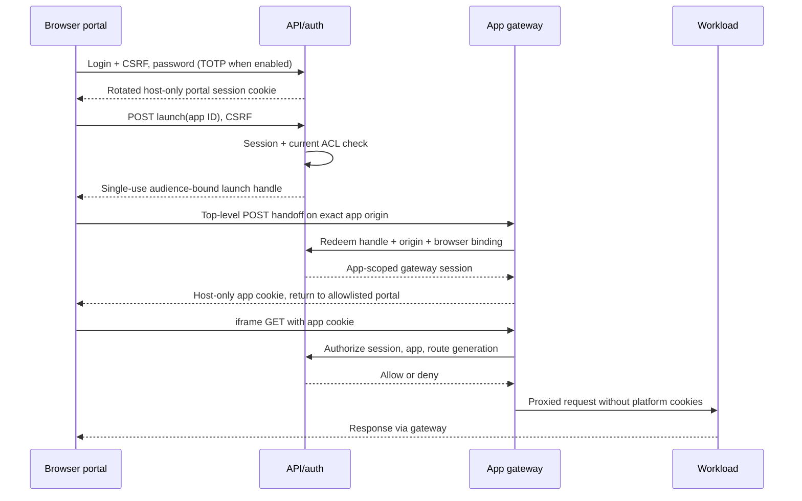

# Embedded applications and browser security

## Integration alternatives

| Model | Compatibility | Browser/security impact | Decision |
|---|---|---|---|
| Path `/apps/id/` on portal origin | Breaks absolute URLs, assets, redirects, base paths and WS; cookie paths are not isolation | Shared DOM/storage/service-worker origin allows app XSS to attack portal; path rewriting cannot fix this | Unsupported for untrusted apps; reviewed trusted legacy mode only by future ADR |
| Distinct app origins in iframe | Needs framing support, correct external URL, cookies and sandbox compatibility | SOP isolates DOM/storage; parent remains portal; independent gateway authorization | Default |
| Hybrid | Per-app compatibility profile and reviewed path opt-in | Adds testing and configuration complexity; silent downgrade dangerous | Long-term only, with same-origin mode explicitly treated as trusted-code execution |

## Recommended origins

Portal: `portal.example.net`; apps preferably `app-id.example-apps.org`, a **different registrable domain**. `app.apps.example.net` is cross-origin but same-site and permits parent-domain cookie tossing/same-site attack classes. Host-only `__Host-` cookies, strict host routing and no portal cookies on app origins reduce but do not eliminate these hazards. Keep the two-domain model as default; same-site deployment needs explicit review and browser tests.

Domain ownership is validated before certificate/routing activation. Optional custom app domains get the same gateway and ACL, never a bypass. Do not route arbitrary wildcard Host values or let repository labels select domains.

## Authentication and launch sequence

### Request-routing boundary

Launch handles expire within 30 seconds, are hashed at rest, single-use, bound to app audience, originating portal session and browser-held nonce via a pre-established handoff cookie. A stolen handle alone is insufficient; no login CSRF or arbitrary redirect. Use POST bodies, no bearer tokens in URLs, Referrer-Policy no-referrer and no third-party assets on handoff pages. Gateway never sends the portal session cookie to apps. Set app gateway cookie at the trusted gateway before any upstream handling; strip spoofed platform cookie Set-Cookie names from upstream responses.

Cross-site iframes may block even `SameSite=None; Secure` host-only cookies after top-level bootstrap. Partitioned cookies/Storage Access API are browser-specific compatibility options, not an assured baseline. If secure embedding fails, present **Open protected application** in a new top-level tab (same gateway auth/ACL) or reject the app/browser pair. Do not disable browser security or put reusable access tokens in frame URLs.

## Switching and catalog

Catalog filters by current ACL; launch rechecks it. Switching removes the old frame, closes portal-owned stream subscriptions, checks new ACL and launches only an approved exact origin. Keep sidebar in the parent. Workload sessions may persist on their own origin; platform logout revokes gateway sessions regardless of workload cookies.

## CSP, sandbox and headers

Portal CSP: default-src self; script-src nonce/hashes with no unsafe-eval; object-src none; base-uri none; frame-ancestors none; frame-src only activated approved app origins; connect-src self plus bounded status endpoints. No wildcard arbitrary origins.

Default iframe sandbox: `allow-scripts allow-forms allow-same-origin` **only for an app origin distinct from portal**. Without allow-same-origin many apps fail with opaque-origin behavior; this is a compatibility/security decision, not permission to share portal origin. Deny top navigation, popups, downloads, camera, microphone, geolocation and clipboard by default via sandbox/Permissions-Policy. Additional powers require reviewed per-app capabilities. Add `referrerpolicy="no-referrer"`.

Application must set compatible `frame-ancestors` explicitly allowing the portal. `X-Frame-Options: DENY/SAMEORIGIN` can prohibit embedding; do not strip or silently override either header. Detect via preflight plus real-browser behavior; static probes cannot prove compatibility. App cookies/storage remain app-owned. Service workers are origin-confined, but remove them via app-origin lifecycle/retirement procedures when retiring a reused origin; prefer never reassigning an old app origin to another app.

`postMessage` is optional, schema-validated, exact source/window and exact origin checked; no wildcard targets or privileged token exchange. Cross-origin redirects may be returned but cannot bypass gateway ACL; only approved local handoff redirects are trusted.

## WebSocket / direct access

Authorize every upgrade against app ACL and exact expected Origin; missing Origin is denied for browser endpoints unless a separately authenticated API-client flow is designed. Revalidate an authorization lease every 5 seconds and close on revocation or auth service outage, target worst-case closure 10 seconds. Do not assume NGINX auth_request rechecks an already upgraded connection; relay owns WS termination and revocation.

Users can navigate to a protected app URL directly. The guarantee is authentication and authorization, **not secrecy of URLs or enforcement of portal-only navigation**. The gateway cannot prove an ordinary HTTP request visually originated inside the sidebar.
