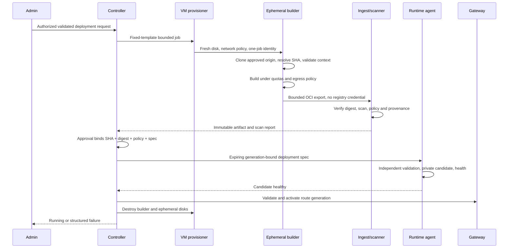
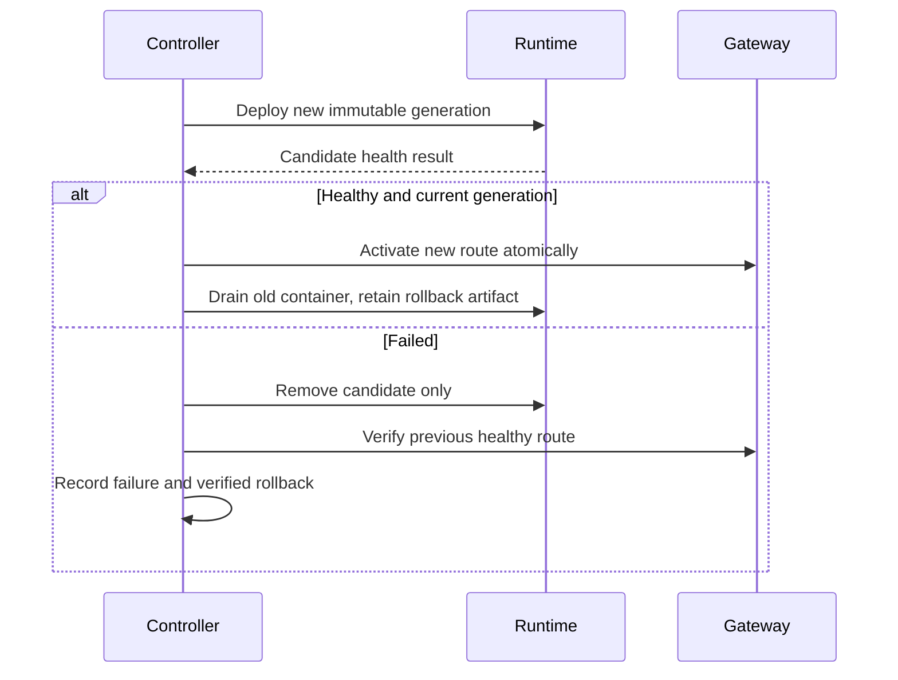

# Secure clone, build and deployment state machine

## Git and build egress

URL validation alone is insufficient: DNS may change, redirects may target internal IPs, Git can invoke helpers, submodules add URLs, and dependency scripts can open their own sockets. Enforce destinations at the network connection boundary outside the untrusted guest.

PH1 accepts HTTPS Git only, port 443, exact approved origins, no userinfo, fragments or ambiguous encoding. Reject SSH, git://, file://, scp syntax and `ext::`. Admin branch names are validated as Git refs and passed as argv after option separators where supported; never concatenate into shell. Resolve advertised branch to SHA in isolated worker and record it before building; subsequent checkout uses that SHA, not a moving branch. Ref mismatches fail closed. Set bounded ref enumeration, shallow clone, object count/size and checked-out disk quota.

Use fresh Git config and HOME, disable system/global configs, hooks, credential helpers and protocol helpers except approved HTTPS transport. Disable recursive submodules, LFS and smudge/filter execution by default. Reject repositories requiring those features; later support requires separately validated mediated fetching of every URL. No repository-supplied Git config is trusted. Export tracked tree into a clean build context without `.git`; handle executable bits and symlinks without following links outside context. Untrusted Git object parsing occurs only in build VM.

Guest has no direct routed internet, DNS, UDP/QUIC or arbitrary CONNECT path. Egress proxy resolves at connection time, validates every A/AAAA answer, rejects mixed public/private results and pins validated IP for connection; rechecks each redirect/connection. Deny loopback, private, link-local, multicast, unspecified, reserved, mapped IPv6, management ranges, host/public management addresses and cloud metadata (including IPv6 and provider-specific endpoints). DNS uses dedicated resolver with no internal zones. Reject redirects by default; future redirect support must revalidate every hop and not forward credentials cross-origin. Connection pooling cannot reuse a socket for a different authority. TLS peer/SNI must match approved hostname; allowlist alone is not sufficient if its destination changes.

Apply same broker to package managers/base image pulls. Build scripts cannot bypass with raw IPs, custom DNS, DoH, UDP or custom proxy variables because VM firewall permits only broker and job ingest. Public allowlists reduce reachable endpoints, not malicious content or exfiltration to allowed hosts. Some dependencies will not build; admin reviews required origins, never adds private ranges. Offline/vendored builds are preferred for sensitive source.

Default budgets: clone 5 min/1 GiB checkout, build 20 min/2 vCPU/4 GiB RAM/10 GiB disk/512 guest PIDs plus host VM quotas, scan 5 min, total 40 min. Operator may increase within fixed host maxima; repository cannot. Heartbeat 10 s, worker lease 30 s, controller sweeper 30 s. Include ingestion/scanning data expansion limits. No shared writable cache; registry cache objects are verified by digest and scoped to avoid private-source leaks.

## Sequence

## States

Every transition writes an append-only event with job/app/actor IDs, old/new state, reason, attempt, timestamps, commit/digest/policy when known, and correlation ID. State and outbox event commit in one SQLite transaction. Never include secret payloads. Timeouts below are initial policy defaults. All state handlers are idempotent and compare expected state/generation.

| State | Checks / work | Timeout | Failure handling and cleanup | Audit event |
|---|---|---|---|---|
| SUBMITTED | Admin+CSRF, bounded request, quota, idempotency, app lock | Queue 10 min | Reject/expire, release reservation | deployment.submitted |
| VALIDATING | URL/ref/paths, Compose schema, capacity, domain/volume ownership; full repo policy repeats after clone | 60 s | FAILED with field codes, no execution resources retained | validation.passed/denied |
| CLONING | Fresh VM attestation/template version, enforced egress, HTTPS credentials mediation, immutable SHA | 5 min | Kill VM, revoke one-job token, delete checkout/disks | clone.started/resolved |
| BUILDING | Bounded context, no secrets, approved frontend, build quotas | 20 min | Kill guest externally, quarantine partial export, destroy disks | build.started/completed |
| SCANNING | Verify digest, safe archive ingest, SBOM, image/runtime policy, vulnerability gate | 5 min | Quarantine/delete unapproved artifact after retention; scanner cleanup | scan.completed/denied |
| APPROVED | Immutable approval tuple and current policy/ACL recheck; auto-policy approval in PH1, manual when configured | 5 min dispatch | Stale approval fails; retain digest only by retention policy | approval.recorded |
| DEPLOYING | Agent identity/spec replay checks, volume ownership, immutable pulls, no ingress | 3 min | Remove candidate resources only; leave previous app running | runtime.created/denied |
| HEALTH_CHECK | Fixed internal probe/port, readiness deadline, no external SSRF; then validated atomic route switch | 2 min | Remove candidate route/resources; restore previous route, compensate or rollback | health.passed/failed, route.activated |
| RUNNING | Current route generation + app identity; continuous health and authorization | No terminal deadline; reconcile 30 s | Alert and bounded restart; new rollout uses new job, never rewrites history | deployment.running, runtime.health |
| FAILED | Structured failure, sanitize logs, previous active generation recorded | Cleanup SLA 2 min | Revoke leases; remove ephemeral compute/network and candidates, retain owned volumes; retry creates new attempt | deployment.failed, cleanup.result |
| CANCELLED | Authorized cancellation CAS, agent/provisioner acknowledgments | Stop/cleanup 2 min | Hard-destroy unresponsive build VM; reconcile late replies; retain preexisting data | deployment.cancelled |
| ROLLED_BACK | Prior approved digest/spec restored, healthy and route verified | 5 min | If rollback fails mark failure, keep route denied or last verified healthy; no false success | deployment.rolled_back |

Legal main path: `SUBMITTED → VALIDATING → CLONING → BUILDING → SCANNING → APPROVED → DEPLOYING → HEALTH_CHECK → RUNNING`. Any pre-running state may reach FAILED/CANCELLED. Cancellation of an already activated candidate is a compensating operation restoring the prior generation; report ROLLED_BACK if verified, not merely CANCELLED. A running deployment is stopped via separate lifecycle operation rather than relabeled as a cancelled build. FAILED update may transition to ROLLED_BACK only after verified compensation; preserve its failure event. RUNNING may reach ROLLED_BACK through an explicit rollback operation. A later update creates a new deployment record.

## Crash, cleanup and rollback

Provisioner owns hard VM expiry independently of controller. Reconciler inventories leased VMs, quarantined blobs, agent objects and route generations. Crash after engine create but before DB commit is recovered by immutable IDs, not duplicate create. Cancellation races require generation check at route activation. Cleanup failure is a visible incident with retries and capacity held until confirmed, never a hidden success.

Database migrations and volume writes can make an older image incompatible. Do not claim automatic rollback of data. Require migration compatibility declaration and backup/restore plan; if unsafe, stop and request operator intervention rather than corrupt data.
