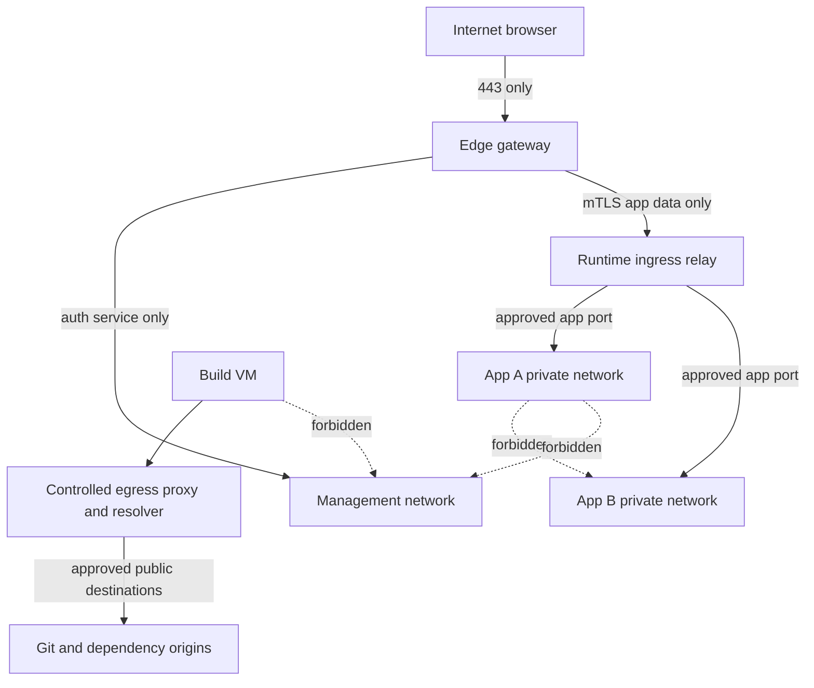

# Network isolation and reverse proxy

## Topology

Only gateway publishes public 443 (80 optionally ACME/HTTPS redirect with no application content). No application Docker host-port publication, even on loopback. Rootless runtime networking is private to the runtime VM; relay joins only authorized app networks or uses an equivalent tested private bridge connector. Relay has no Docker socket and no open generic CONNECT proxy. Backend destinations are resolved from signed route records and constrained IP/port sets, never browser-provided URLs.

Applications cannot reach the runtime agent, relay control listeners, host bridge, hypervisor, management network, registry credentials or cloud metadata. Relay must not be a path back into management. Hypervisor firewall isolates VM NICs, source anti-spoofing and explicit service endpoints. Runtime isolation also requires app-level namespace/firewall or externally separated networking: rootless user-space networking can collapse source identity, so per-app egress restrictions and lateral denial must be proven by tests. If the selected rootless driver cannot enforce them, use a validated per-app network broker or per-app VM, not blanket outbound access.

Default application egress deny; allow reviewed DNS and approved public HTTP(S) via egress broker if needed. Databases in one Compose app get app-private network connectivity only, with no cross-app routes. One ingress service/port per app in PH1. IPv6 is either equally filtered end-to-end or disabled; an IPv4-only blocklist is insufficient.

## Proxy selection

| Proxy | Strengths | Security/operational costs |
|---|---|---|
| NGINX | Small explicit config, mature HTTP/WS, auth_request | Auth subrequests do not revoke established WS; reload/config generation needs care; TLS automation external |
| Caddy | Simple TLS automation, reverse_proxy, forward_auth | Dynamic config authority must be isolated; app auth and long-lived revocation still custom |
| Traefik | Dynamic services, middleware and certificates | Docker provider invites socket access; labels are untrusted policy input; more discovery surface than needed |

Select **NGINX** with auth_request for HTTP plus a narrow Go relay for WebSocket/stream revocation and runtime tunnel. No Docker discovery provider. Caddy is a valid later alternative after equivalent tests; do not run two policy engines in MVP.

## Request validation

- Exact SNI/Host allowlist, normalize ports/IDNA/case; reject duplicate/malformed Host, unknown host, ambiguous paths and untrusted absolute-form requests. Canonical app IDs come from route inventory, not X-Forwarded-Host.
- Auth endpoint receives gateway-generated app ID and normalized request context over a trusted channel. Client `X-User`, `X-Role`, `X-App`, `Forwarded`, auth result and forwarding headers are stripped/overwritten. Runtime workloads cannot call internal auth endpoints as a trusted proxy.
- Strip platform session cookies and internal Authorization values before upstream. Preserve application auth separately with documented cookie namespace protection. Disable shared caching of protected responses; never cache auth subrequest success indefinitely.
- Forwarded identity, if supported, is opt-in with signed audience-bound claims and origin validation; it never grants the app management authority.
- Reject CRLF, directive syntax and oversized input. Domain/slug are data fields rendered via typed templates, not string concatenation or `include` paths.
- Set proxy/body/time limits, header limits and sane buffering. Streaming limits and authorization leases are enforced at relay, not just upgrade time.

## Optional DNS

PH1 can use operator-managed local hosts entries with a locally trusted certificate and separate origins. This avoids mandatory public DNS, not the need for distinct origins/TLS. Production public access needs owned domains and a supported CA. A single IP and different ports is not the default embedding model; cookie scope and origin compatibility differ. DNS-less deployment is a setup mode, not wildcard routing to arbitrary hosts.

## Atomic route lifecycle

Compile immutable route generation from approved app ID/domain/backend records. Validate config syntax with `nginx -t` in an isolated validation context and semantic ownership checks. Health-check candidate backend before generating public route. Atomically install generation, reload, probe authenticated and unauthorized paths, record active generation. On failure restore previous known-good generation and drain candidate. If auth component is unhealthy, respond deny/503, never fall through to workload. A controller crash reconciles desired/observed generations without publishing a candidate prematurely.
