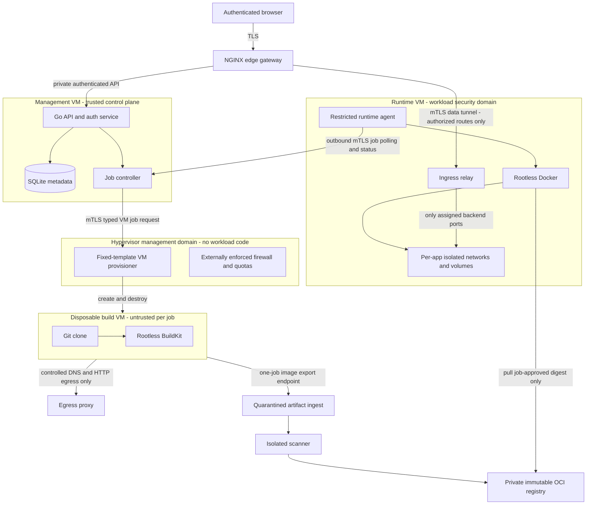
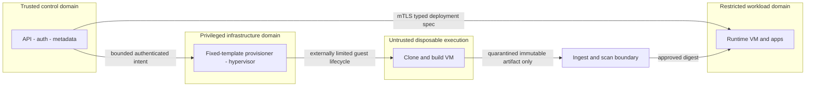

# Recommended security architecture

## Overall architecture / trust boundaries

Arrows are explicit permitted flows, not general routing grants. Edge, ingestion, scanner and registry are individually constrained services; they must not share management DB credentials or the Docker socket. They may share dedicated infrastructure VMs initially but are not co-located with untrusted build execution.

## Authority boundaries

1. Browser input never becomes Docker API payloads, proxy configuration or shell commands directly.
2. API authorizes intent. Controller compiles a versioned normalized deployment spec; agent independently validates it. Only the runtime agent accesses its guest's rootless socket.
3. Host provisioner accepts fixed template ID, job ID and bounded quotas, not shell, arbitrary libvirt XML, disk paths or arbitrary interfaces. It cannot be reached by guests. Its compromise remains highly privileged.
4. Builder gets a one-time bootstrap identity permitting only that job's bounded artifact upload/status path, not general control API access. It receives no registry push, management or runtime credentials.
5. Scanner treats images and SBOMs as untrusted; it runs in an isolated sandbox/VM with limited filesystem and egress. Successful scanning is not a malware verdict.
6. Agent identity is scoped to a worker; routing identity is separate and cannot deploy. Management compromise can request permitted deployments but cannot bypass agent hard policy or demand host paths.

## Scheduling and ownership

Single controller, single build slot initially. Job leases, monotonic generation numbers and per-app locks avoid double deployment. Idempotent commands carry deployment ID, app ID, expected worker/spec version, digest, expiry and nonce. No arbitrary exec endpoint. Expired/replayed commands are rejected; agents reconcile only platform-owned objects with matching IDs, not arbitrary containers.

## Availability and blast radius

Reserve host RAM/CPU/disk for management; guest quotas are enforced outside guests. Runtime VM compromise threatens all apps in that VM and their volumes. Shared physical host failure stops everything. Long-term dedicated hosts and per-app VMs reduce these risks. Container isolation is not represented as complete protection against malicious workloads.

## Secure MVP release boundary

No real repository builds before egress escape tests pass. No application publication before auth gateway, no-host-ports, ACL default-deny and route validation pass. No rootful runtime fallback to solve compatibility; approve and document an alternative VM-isolated profile in a future decision, or reject the app.
