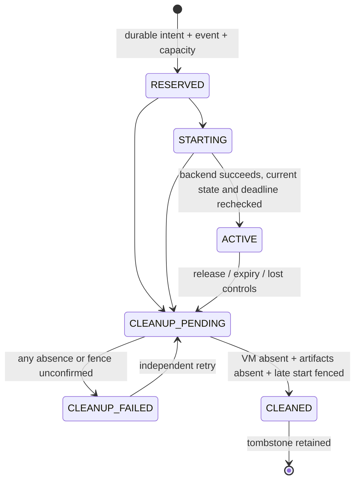

# P1-M04 — build provisioner core and remaining Linux gate

## Status: PARTIAL, not accepted for real builds

Linux operator checklist: [P1-M04 Debian-based Linux VM test plan](../testing/P1-M04-linux-checklist.md). It separates runnable software verification from the still-blocked real KVM acceptance cases.

Implemented: strict fixed-template request, independent durable host lease ledger, lifecycle/cleanup manager, controller-only mTLS transport, and disabled-by-default command. **Not implemented/proven:** a real Linux KVM/libvirt backend, image artifact, kernel resource enforcement, host deadline kill/fencing or actual VM create/destroy tests. P1-M04's guest-create/destroy/expiry acceptance gate remains **open**. Never count a simulator as isolation evidence.

The shipped `cmd/provisioner` hard-codes `UnconfiguredBackend`. It cannot create VMs or confirm resource cleanup and has no simulator/unsafe/backend-selection flag. Valid create requests return 503 without reserving resources. Guard mode refuses to claim readiness. Merely moving this binary to Linux does not enable it.

## Boundary / implemented components

- `api/build-lease.schema.json`, `api/provisioner.openapi.yaml`: separate service protocol, not portal endpoints.
- `internal/provisioner`: ledger, fixed profiles, immutable leases, replay/idempotency, lifecycle and host-local sweep/guard loop.
- `internal/provisionerrpc`: TLS 1.3 mutual auth, explicit client CA, sole controller URI SAN, leaf pin and per-request certificate validation.
- `cmd/provisioner`: optional **loopback-only prototype** service; separate host credential files and ledger. No shell/libvirt/Docker invocation or host network manipulation.
- `*_test.go`: simulator-only backend plus actual SQLite and real local mTLS transport tests. Simulated VM maps never ship in the executable.

There is no import of management auth/storage into the provisioner domain, no portal cookie authority, and no management DB mount. Shared contract schema code carries no management credentials. There is no build runner, Git fetch, cloud-init credential injection or VM template image in this increment.

## Request and quota contract

Controller supplies schema version, command/job/app/deployment UUIDs, approved template ID, `build-small-v1` profile, random 256-bit nonce and absolute expiry. No controller ID claim, path, URL, XML, interface, network, shell, device, resource override or secret is accepted. Identity comes from the certificate. Template ID resolves against an operator-owned ID/digest catalog; catalog digest is part of the request fingerprint. A digest string alone is not proof that image bytes were measured.

| Fixed profile control | Required future backend enforcement |
|---|---|
| 2 guest vCPUs; 2000 host CPU millis | Bound the whole VM/QEMU execution group, not just vCPU count |
| 4096 MiB guest; 4608 MiB host memory | Guest allocation plus bounded emulator overhead; no unbounded swap |
| 10240 MiB virtual disk; 11264 MiB physical budget | Real filesystem/block quota including COW metadata; virtual image size alone insufficient |
| 1000 disk IOPS | External block IO throttling |
| 128 host PIDs | Bound QEMU/helper host processes/threads |
| 512 guest runner PIDs | Defense in depth only; malicious guest root can bypass guest-local limits |
| One active/unconfirmed build | SQLite partial unique index; no capacity reuse before confirmed cleanup |
| At most 30-minute immutable lease | Host deadline enforcement independent of controller/guest |

Values are a proposed initial fixed profile, **not measured supported host capabilities**. A changed/wider policy requires a new reviewed profile ID rather than silently weakening v1. The existing single-server RAM/KVM assumptions still need operator approval (Q01/Q05).

## Independent ledger

`OpenLedger` requires its own private local file/directory (Unix 0600/0700; Windows ACLs operator-managed). It rejects memory/URI/UNC modes, direct symlinks, incompatible application ID/version and changed schema checksum. It refuses the management metadata DB or an arbitrary preexisting file instead of adding host tables there. WAL/FULL sync, FK enforcement, busy timeout and immutable history are checked; connection replacement reapplies PRAGMAs.

Tables: ledger checksum/version, guard heartbeat, leases, append-only lifecycle events. Lease identity, deadline, nonce hash, fingerprint and random host ownership proof cannot be updated/deleted through ordinary SQL. Tombstones prevent job/command/nonce reuse. State and its versioned event commit together under BEGIN IMMEDIATE; no hypervisor calls occur inside DB transactions.

The host proof is private and never returned by RPC or logged; a future backend must match it against VM/artifact metadata before any destructive operation. Name prefixes alone are not ownership. Ledger writes are not defense against a compromised host/database owner. Retention/encrypted backups and disaster recovery for this separate ledger are still future work; do not share the management backup file or mount it into guests.

## State machine / cleanup

Same command/fingerprint is idempotent and never extends expiry or recreates a cleaned job. Different job with a reused command or nonce conflicts. One pending/active/cleanup-failed lease holds the single slot. An idempotent concurrent retry may see RESERVED/STARTING and should query status, not assume readiness.

Accepted cleanup gets an independent bounded context even if the RPC/controller disappears. Unconfirmed cleanup retains capacity and durable pending/failed state. Foreign ownership collisions quarantine the slot instead of deleting another VM. A failed event write rolls back the corresponding state transition. An I/O/commit failure can have uncertain outcome; query existing job identity, never blindly repeat external effects.

Host-local sweep recovers expired jobs, startup interrupted for ≥1 minute, prior cleanup failures and invalid/lost controls. Successful sweeps refresh a heartbeat; admission requires age ≤10 seconds. Intended guard process tick is 2 seconds; normal shutdown clears readiness. Watchdog does not renew leases and has no public RPC endpoint.

**A ticker/context is not a hard VM kill guarantee.** A stalled/crashed guard, inaccessible ledger, wall-clock rollback, delayed hypervisor RPC and create-versus-destroy races require real externally enforced monotonic deadlines and late-start fencing. Thus the shipped backend reports every enforcement control false. No code claims that logical lease expiry itself stops a guest. Cleanup absence/fence assertions are a future backend obligation requiring host evidence, not caller-supplied booleans.

## Controller authentication

Only the explicit client CA is trusted (no public CA fallback). Require clientAuth EKU, non-CA leaf, exactly one URI SAN `spiffe://dev-orchestrator/controller/<configured UUID>`, approved leaf SHA-256 pin and total leaf validity ≤24 hours. CommonName/DNS/worker identity are not controller authority. Recheck validity/pin on every request, including an existing TLS connection. TLS tickets are disabled; 1–2 pins allow deliberate overlap. Revocation currently requires updating pins and restarting the service; enrollment/automatic rotation are not implemented.

Reject cookies, browser Origin and forged Host/identity headers. No CORS/browser mode, bearer/portal fallback, arbitrary exec, force delete or arbitrary network management exists. GET/release is owning-controller only. No host proof, raw nonce or filesystem information is returned. Errors are static codes; request bodies, certificates' private keys and backend error details are not echoed.

## Prototype operation

Do not install this as a production hypervisor service yet. Optional diagnostics use `go run ./cmd/provisioner` with explicit `-ledger`, pinned `-template-digest`, `-controller-id`, public `-controller-cert-sha256`, `-client-ca`, `-tls-cert`, `-tls-key`, and exact `-authority`. Default bind is `127.0.0.1:9444`; prototype forbids non-loopback bind. Credential inputs are bounded regular files; private key Unix permissions are restricted. No services/VMs/firewall rules are installed by this code.

Only an approved mTLS client can read capabilities. Expect `execution_enabled:false`; POST create must return 503. `-mode guard` returns unavailable with the shipped backend, not fake healthy heartbeats. All simulation is test-only. Portal `/api/v1/admin/status` continues to report deployment execution disabled independently.

## Remaining P1-M04 work before acceptance

1. **M04-B / host decision:** operator-approved Linux LTS KVM/libvirt lab, sufficient reserved resources, private control NIC, quota-capable storage, maintained kernel/hypervisor, and explicit permission to provision test VMs. Windows/WSL/mock execution is not evidence.
2. **M04-C / fixed Linux backend:** pinned immutable read-only template with no host credentials; initially no NIC, shared folder, socket, vsock/agent control channel or host mount. Resolve image paths exclusively from protected host configuration. Verify image bytes, architecture, private ownership metadata and actual engine constraints. No repository-selected XML or shell strings.
3. **M04-D / hard deadline and fencing:** independent host-monotonic kill registration before guest start, guard crash/restart behavior, late-start rejection after cancellation/expiry, safe hypervisor-call timeout handling and ownership-verified artifact/quota release. Confirm no delayed create can succeed after cleanup was acknowledged. No-op timers or simple process cancellation are not acceptable substitutes.
4. **M04-E / real acceptance:** actual fresh guest create, external CPU/RAM/PID/disk/IO budgets, foreign-resource protection, expired lease termination after controller loss, provisioner/guard crash cases, host clock changes, partial-create cleanup and slot retention on failure. Record kernel/libvirt/template/policy versions and actual inventory evidence.
5. Only after these pass may an executable link a real backend. M05 then adds externally verified broker-only network access; M06 controlled cloning; M07 builds. No arbitrary repositories before their gates.

Shared hardware/hypervisor escape, host-root compromise, denial of service, guest-root bypass of guest-local limits and SSD physical erasure remain residual risks even after implementation. This is not complete malicious-workload isolation and is not a Kubernetes scheduler.
