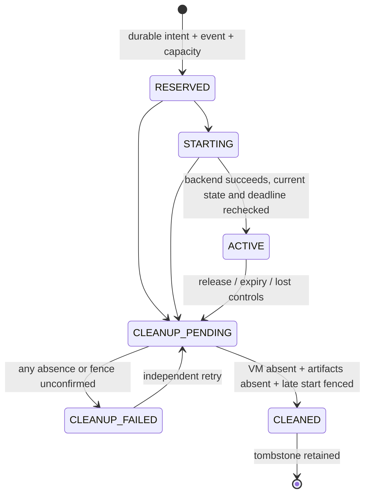

# P1-M04 — build provisioner core and remaining Linux gate

## Status: Implemented/tested*

\* V14 and V15 marked as SKIP. V01–V13 and V16 passed; skipped cases are not passes. See the [acceptance record](../testing/P1-M04-acceptance-report.md).

Mandatory gate: [Linux checklist](../testing/P1-M04-linux-checklist.md), [real-host execution](../testing/P1-M04-real-host.md), and [acceptance record](../testing/P1-M04-acceptance-report.md). All required tests MUST actually execute successfully before M04 is marked PASS. Cross-compilation or skipped host tests do not count.

Implemented: fixed-template/mTLS/ledger lifecycle plus a Debian/Linux QEMU/KVM backend, pinned raw-image copy, preallocated bounded disks, systemd CPU/memory/task limits, QEMU IO throttle, disconnected unprivileged guests, independent boot-time deadlines, durable fences, ownership/inode-checked cleanup and opt-in real-host tests. **Not proven on the Windows development host:** real Linux boot/enforcement/failure behavior. The operator supplies and reviews the credential-free boot image; no opaque image artifact is shipped. The current recorded aggregate is the qualified PASS* above.

The default backend remains `disabled`: create returns 503 and guard refuses readiness. Explicit `-backend linux-kvm -linux-config /var/lib/orchestrator-builder/host/backend.json` selects real execution only on a configured root-owned Linux/KVM host. Unsupported hosts/backends fail closed; no simulator/TCG/container fallback. See the [host runbook](../../infra/builder/README.md). No automatic installer or service enablement runs.

## Boundary / implemented components

- `api/build-lease.schema.json`, `api/provisioner.openapi.yaml`: separate service protocol, not portal endpoints.
- `internal/provisioner`: ledger, fixed profiles, immutable leases, replay/idempotency, lifecycle and host-local sweep/guard loop.
- `internal/provisionerrpc`: TLS 1.3 mutual auth, explicit client CA, sole controller URI SAN, leaf pin and per-request certificate validation.
- `cmd/provisioner`: loopback-only mTLS service, explicit backend configuration, guard and internal systemd guest/expiry entry points. No shell/libvirt/Docker invocation or guest network attachment.
- `linux_backend_linux.go`: fixed QEMU command, systemd units/timer, private host journal and FD-only disk handoff. Direct QEMU rather than libvirt keeps the entire guest inside the owned deadline unit.
- `*_test.go`: model/SQLite/mTLS tests plus explicitly authorized Linux real-host cases. Simulated VM maps never ship in the executable.

There is no import of management auth/storage into the provisioner domain, no portal cookie authority, and no management DB mount. Shared contract schema code carries no management credentials. There is no build runner, Git fetch, cloud-init credential injection or VM template image in this increment.

## Request and quota contract

Controller supplies schema version, command/job/app/deployment UUIDs, approved template ID, `build-small-v1` profile, random 256-bit nonce and absolute expiry. No controller ID claim, path, URL, XML, interface, network, shell, device, resource override or secret is accepted. Identity comes from the certificate. Template ID resolves against an operator-owned ID/digest catalog; catalog digest is part of the request fingerprint. A digest string alone is not proof that image bytes were measured.

| Fixed profile control | Linux backend enforcement (acceptance pending) |
|---|---|
| 2 guest vCPUs; 2000 host CPU millis | Bound the whole VM/QEMU execution group, not just vCPU count |
| 4096 MiB guest; 4608 MiB host memory | Guest allocation plus bounded emulator overhead; no unbounded swap |
| 10240 MiB virtual disk; 11264 MiB physical budget | Preallocated fixed raw disk, no COW/backing chain/logs; fixed file-size ceiling; inode-verified bounded metadata. Shared immutable template is outside per-job allocation |
| 1000 disk IOPS | External block IO throttling |
| 128 host PIDs | Bound QEMU/helper host processes/threads |
| 512 guest runner PIDs | Defense in depth only; malicious guest root can bypass guest-local limits |
| One active/unconfirmed build | SQLite partial unique index; no capacity reuse before confirmed cleanup |
| At most 30-minute immutable lease | Host deadline enforcement independent of controller/guest |

Values are a proposed initial fixed profile, **not measured supported host capabilities**. A changed/wider policy requires a new reviewed profile ID rather than silently weakening v1. The existing single-server RAM/KVM assumptions still need operator approval (Q01/Q05).

## Independent ledger

`OpenLedger` requires its own private local file/directory (Unix 0600/0700; Windows ACLs operator-managed). It rejects memory/URI/UNC modes, direct symlinks, incompatible application ID/version and changed schema checksum. It refuses the management metadata DB or an arbitrary preexisting file instead of adding host tables there. WAL/FULL sync, FK enforcement, busy timeout and immutable history are checked; connection replacement reapplies PRAGMAs.

Tables: ledger checksum/version, guard heartbeat, leases, append-only lifecycle events. Lease identity, deadline, nonce hash, fingerprint and random host ownership proof cannot be updated/deleted through ordinary SQL. Tombstones prevent job/command/nonce reuse. State and its versioned event commit together under BEGIN IMMEDIATE; no hypervisor calls occur inside DB transactions.

The host proof is private and never returned by RPC or logged. Linux matches proof-derived systemd descriptions and durable private state, plus disk device/inode/link identities before removal. Name prefixes alone are not ownership. Ledger writes are not defense against a compromised host/database owner. Retention/encrypted backups and disaster recovery for this separate ledger are still future work; do not share the management backup file or mount it into guests.

## State machine / cleanup

Same command/fingerprint is idempotent and never extends expiry or recreates a cleaned job. Different job with a reused command or nonce conflicts. One pending/active/cleanup-failed lease holds the single slot. An idempotent concurrent retry may see RESERVED/STARTING and should query status, not assume readiness.

Accepted cleanup gets an independent bounded context even if the RPC/controller disappears. Unconfirmed cleanup retains capacity and durable pending/failed state. Foreign ownership collisions quarantine the slot instead of deleting another VM. A failed event write rolls back the corresponding state transition. An I/O/commit failure can have uncertain outcome; query existing job identity, never blindly repeat external effects.

Host-local sweep recovers expired jobs, startup interrupted for ≥1 minute, prior cleanup failures and invalid/lost controls. Successful sweeps refresh a heartbeat; admission requires age ≤10 seconds. Intended guard process tick is 2 seconds; normal shutdown clears readiness. Watchdog does not renew leases and has no public RPC endpoint.

**A ticker/context is not a hard VM kill guarantee.** Linux records an absolute CLOCK_BOOTTIME deadline/boot ID before allocation, registers a separate PID-1 alarm timer before guest start, and runs a timerfd supervisor inside the VM's systemd lifetime unit. A frozen supervisor is killed by the independent expiry service; supervisor death triggers control-group teardown. A host-wide flock and permanent tombstones fence delayed helper starts. Cleanup requires stopped units, empty guest cgroup and verified file removal. Assertions still require real-host evidence; kernel/PID1 failure remains a residual risk.

## Controller authentication

Only the explicit client CA is trusted (no public CA fallback). Require clientAuth EKU, non-CA leaf, exactly one URI SAN `spiffe://dev-orchestrator/controller/<configured UUID>`, approved leaf SHA-256 pin and total leaf validity ≤24 hours. CommonName/DNS/worker identity are not controller authority. Recheck validity/pin on every request, including an existing TLS connection. TLS tickets are disabled; 1–2 pins allow deliberate overlap. Revocation currently requires updating pins and restarting the service; enrollment/automatic rotation are not implemented.

Reject cookies, browser Origin and forged Host/identity headers. No CORS/browser mode, bearer/portal fallback, arbitrary exec, force delete or arbitrary network management exists. GET/release is owning-controller only. No host proof, raw nonce or filesystem information is returned. Errors are static codes; request bodies, certificates' private keys and backend error details are not echoed.

## Prototype operation

Do not install this as a production hypervisor service yet. Optional diagnostics use `go run ./cmd/provisioner` with explicit `-ledger`, pinned `-template-digest`, `-controller-id`, public `-controller-cert-sha256`, `-client-ca`, `-tls-cert`, `-tls-key`, and exact `-authority`. Default bind is `127.0.0.1:9444`; prototype forbids non-loopback bind. Credential inputs are bounded regular files; private key Unix permissions are restricted. No services/VMs/firewall rules are installed by this code.

Only an approved mTLS client can read capabilities. Default disabled mode reports `execution_enabled:false`; explicit Linux configuration plus a fresh guard can enable guest execution. Capabilities are implementation assertions, not an M04 acceptance certificate. All simulation is test-only. Portal `/api/v1/admin/status` continues to report deployment execution disabled independently.

## Deferred work and unqualified acceptance

The real-host execution and filesystem-identity recovery are complete. V14 and V15 are deferred by operator request. The following requirements describe an unqualified PASS rather than replacing the recorded PASS*:

1. Approve the isolated Linux lab, host configuration, maintained hypervisor and credential-free pinned image.
2. Execute every required software and real-host test, including workload/fault cases V01–V16, and retain actual kernel/process/storage/timing evidence. No skipped/blocked test counts as PASS.
3. Review the exact implementation/image/policy and sign the acceptance record. **M04 MUST NOT PASS before successful execution.**
4. Only after acceptance proceed to M05 broker-only networking, M06 cloning and M07 builds. No arbitrary repositories before those separate gates.

Shared hardware/hypervisor escape, host-root compromise, denial of service, guest-root bypass of guest-local limits and SSD physical erasure remain residual risks even after implementation. This is not complete malicious-workload isolation and is not a Kubernetes scheduler.
