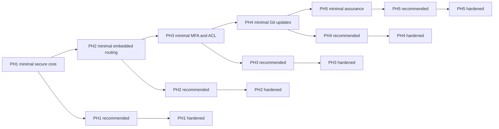

# Master roadmap and execution contract

## Interpretation of the fifteen plans

Every phase has minimal, recommended and hardened plans. They are **cumulative tracks**, not three unrelated products:

- Minimal: complete that phase's minimal plan on the preceding phase baseline.
- Recommended: complete that phase's minimal tasks, then recommended additions.
- Hardened: complete minimal + recommended + hardened additions.

Each document explicitly imports its prerequisites, architecture, test contracts and baseline deliverables. A future session can execute one task using its listed inputs, outputs and gate; it must not claim the entire phase complete after one task. Hardening never removes PH1 VM, authorization, egress or runtime controls. Selecting minimal for a later phase does not require unrelated earlier optional additions unless explicitly stated. Task IDs are globally unique; cross-track prerequisites must be followed.

## Dependency graph

TOTP required day one creates an explicit additional dependency from PH3 MFA tasks into PH1 release; development order may change without dropping their prerequisites. Minimal PH1 includes authenticated protected app access in a top-level tab; PH2 adds the complete embedded experience and routing automation. Basic atomic route validation and isolation exist already PH1. Baseline scanning exists PH1; PH5 improves intelligence/assurance.

## Shared task execution contract

Inputs: referenced architecture/implementation specs, prerequisite task artifacts and existing repository inspection. Every task updates tests and relevant docs, introduces no out-of-scope feature, and records assumptions. Outputs must include code path list (when implementation is approved), tests executed, evidence, residual risks and next dependency. Task completion requires its gate plus code review; no self-attested security guarantee without test evidence. Integration tasks may require multiple sessions; split locally into suffixed IDs before implementation if too large, keeping one deliverable per commit.

Task complexity: S ~0.5–1 engineer-day, M ~1–3, L ~3–5; uncertainty ±50% and research spikes additional. Phase estimates are sums plus review/integration, not delivery commitments. Large security mechanisms below are divided into contract, implementation and external verification tasks. Parallel means independent branches/files after shared contracts; no automatic authorization to spawn agents.

## Critical release gates

PH1: SEC-01–11,13,16–17 plus full default-deny request checks, actual guest isolation proof, no app host ports, independent agent policy, cleanup and authenticated status. PH2: browser origin isolation and WS/SSE lease revocation. PH3: TOTP/recovery/admin/user/ACL UX plus timed revoke suite. PH4: immutable updates, race-safe route switch and data-safe rollback refusal. PH5: complete adversarial/restore review with no unresolved critical blockers.

## Suggested first task

**P1-M01: establish project contracts, threat-test fixtures and isolation capability checklist.** It is safe to implement after authorization without deploying real workloads. Before proceeding to real repository builds, complete P1-M04–M06 isolation tests on approved Linux hardware. User must switch out of Plan mode; approval alone does not permit implementation while this mode remains active.
