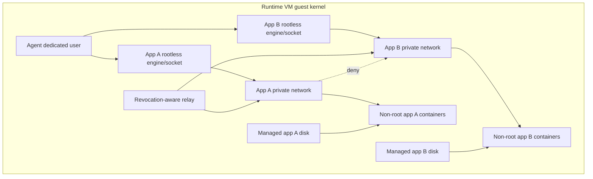

# Runtime agent and build-worker lifecycle

## Runtime agent

The current M09 recovery design uses a dedicated Unix account inside the runtime VM and a separate rootless engine/socket/data root and user namespace for each app. Durable app reservations and measured bindings select the backend; the agent cannot route an app command to a shared engine. Bounded provisioning and measured enforcement now have concrete implementations and isolated development diagnostics; the complete acceptance suite is still incomplete. No generic shell, exec console, arbitrary Docker API or arbitrary filesystem RPC. Supported operations: validate capability, prepare image by approved digest, create candidate, inspect status, bounded logs, stop/drain, remove owned container/network, managed volume attach/backup/delete. Agent never receives management DB keys. Relay is separate identity and cannot deploy.

Before claiming ready: verify cgroup delegation/limits, user mappings, seccomp/MAC, disk quotas, no management/host reachability, engine API version and private relay connectivity. Report signed capability/version inventory; controller schedules only matching profiles. After create, inspect engine state to ensure actual constraints equal intended state. Reconciliation never deletes foreign engine objects. Worker loss revokes routes and identity lease; it does not attach volumes simultaneously on a replacement.

## Build VM lifecycle

1. Controller reserves host quota and creates lease/job identity.
2. Provisioner selects pinned patched read-only template; creates fresh copy-on-write disk with hard disk size/IOPS, vCPU and memory caps. No host directory, socket, shared folder, clipboard, USB or cloud metadata service mounted/exposed.
3. Attach isolated NIC with anti-spoofing and broker/ingest-only firewall. No guest route to provisioner or management. Minimal one-job bootstrap material delivered through a restricted mechanism; remove before repository execution where possible.
4. Guest runner confirms template and job context, clones and builds without sensitive secrets. Guest root compromise is assumed possible; hard timeout and quotas are enforced outside guest.
5. Export bounded OCI artifact via job-specific upload endpoint. Ingestion safely validates tar paths, counts, decompression limits and OCI digest graph; malicious archive never extracted into trusted host paths.
6. Provisioner stops/destroys VM, revokes token and removes ephemeral disks/network leases regardless of success. Sensitive source disk deletion is best-effort logical cleanup on encrypted storage; secure physical erasure of SSD blocks is not promised.
7. Independent expiry sweeper inventories leases and kills orphan guests; record cleanup confirmation and keep resource reservation while cleanup is uncertain.

No reuse of a guest that has executed untrusted content. A warm pool may contain only never-used guests. Do not reuse writable workspaces/caches across private repos. Image template updates are signed/versioned and rebuildable; patch critical kernel/hypervisor/build-tool CVEs before admitting new jobs.

## Recovery and agent identity

Agent polls mTLS controller, bounded command queue and heartbeat. Idempotency ledger is durable in runtime VM. Certificate rotation uses overlap but revocation is checked before new actions. Revoked worker cannot continue pulling artifacts; existing apps are quarantined/isolated by external network control when feasible. If runtime VM is compromised, assume agent output/attestation untrustworthy; rebuild and rotate all app secrets present there.

Agent control surface tests include replay, wrong worker/app ID, expired command, stale generation, invalid mount ID, symlink race, engine drift, daemon restart and malformed logs. Long-term split storage/host networking helpers from rootless agent with fixed narrow interfaces; do not expand agent to host root for convenience.
